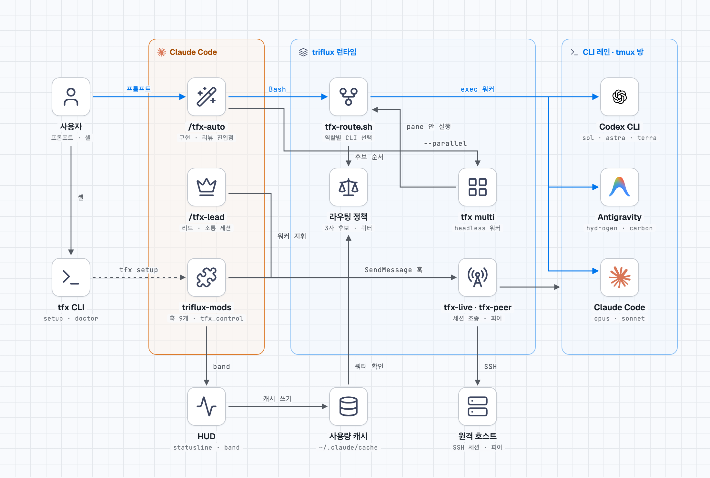
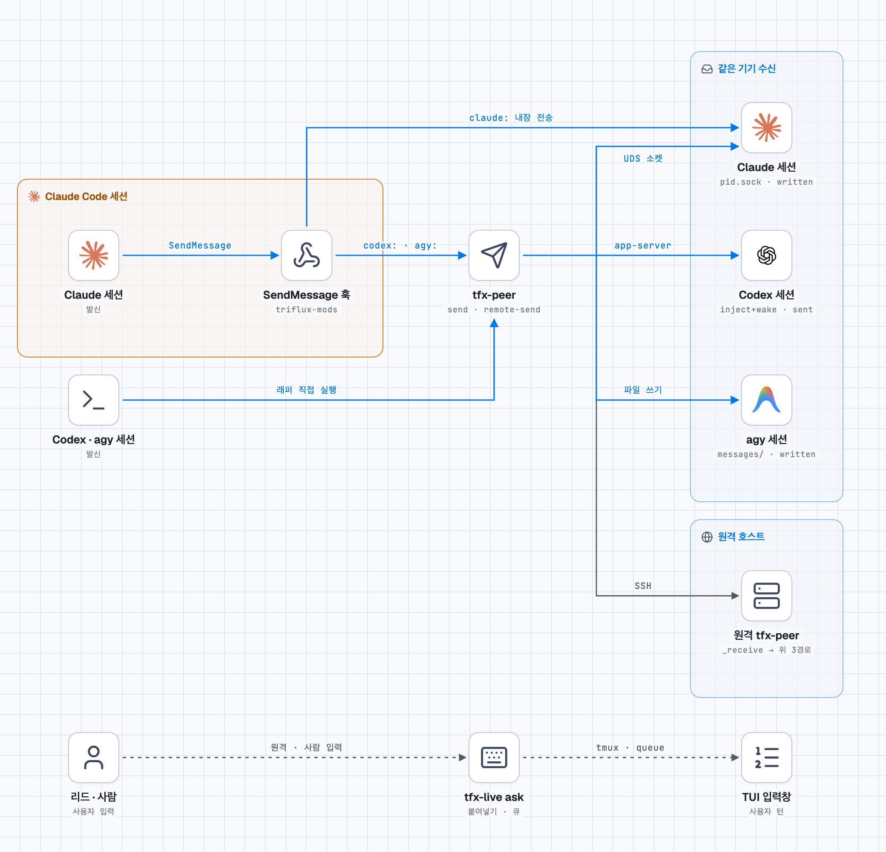

[English](README.md) | [한국어](README.ko.md)

<p align="center">
  <picture>
    <source media="(prefers-color-scheme: dark)" srcset="docs/assets/logo-dark.svg">
    <source media="(prefers-color-scheme: light)" srcset="docs/assets/logo-light.svg">
    
  </picture>
</p>

<h3 align="center">Claude Code, Codex, Antigravity를 함께 쓰는 CLI 오케스트레이터</h3>

<p align="center">
  <a href="https://www.npmjs.com/package/triflux"></a>
  <a href="https://www.npmjs.com/package/triflux"></a>
  <a href="https://github.com/tellang/triflux/stargazers"></a>
  = 22">
  <a href="https://opensource.org/licenses/MIT"></a>
</p>

## 목적

triflux는 Claude Code 플러그인과 npm CLI로 구성된 오케스트레이터다. 주요 기능은 세 가지다.

- 작업 라우팅: 역할(구현, 리뷰, 설계 등)마다 Codex CLI, Antigravity CLI(`agy`), Claude Code 중 어느 CLI와 모델로 실행할지 정하고 실행한다.
- 세션 운영: tmux에서 실행 중인 Claude, Codex, agy 세션을 시작, 질의, 압축, 종료하고 세션끼리 메시지를 주고받게 한다.
- 리드 운영: 한 세션이 리드를 맡아 다른 세션을 워커로 등록하고 지시, 교차 리뷰, 머지까지 관리한다.

## 전체 구조

<picture>
  <source media="(prefers-color-scheme: dark)" srcset="https://raw.githubusercontent.com/tellang/triflux/main/docs/assets/architecture-ko-dark.png">
  
</picture>

- `/tfx-auto`는 Claude Code 안에서 Bash로 `tfx-route.sh`를 실행한다.
- `tfx-route.sh`는 라우팅 정책 모듈에서 역할별 후보 순서를 받아 첫 후보 CLI를 비대화식 워커로 실행한다.
- 라우팅 정책은 HUD가 기록한 사용량 캐시를 읽어 한도에 걸린 벤더를 후보에서 제외한다.
- `tfx multi`는 tmux 방에 워커 pane을 생성한다. headless 실행이면 각 pane이 `tfx-route.sh`를, Claude 워커는 `claude --print`를 실행한다. 대화형 실행이면 pane에서 각 CLI의 TUI를 시작하고 프롬프트를 입력한다.
- `tfx-live`와 `tfx-peer`는 사람이 쓰는 대화형 세션을 제어한다. 메시지 경로는 아래 "세션과 피어 메시지" 절에 있다.

## 요구 사항

- Node.js 22 이상
- macOS와 Linux는 tmux, Windows는 psmux와 Windows Terminal
- 실행할 CLI: Codex CLI, Antigravity CLI(`agy`), Claude Code 중 이 기기에서 쓸 것. 쓰지 않는 CLI는 설치 때 머신 프로필에서 제외한다.
- triflux-mods: Claude Code 2.1.287 이상

## 설치

```bash
npm install -g triflux --allow-scripts=triflux   # npm 12 이상은 설치 스크립트를 허용해야 setup이 실행된다
tfx setup                                        # 대화형 설정
tfx doctor                                       # 점검
```

- postinstall은 `scripts/setup.mjs`를 실행해 스크립트, HUD, 스킬, Codex 프로필, 머신 프로필을 설치하고 Codex 훅을 등록한다.
- postinstall과 CI에서는 묻는 단계를 건너뛰고 안내만 남긴다. mods, agy 플러그인, 리드 실행 명령, 피어 어댑터 승인, Codex 훅 신뢰 승인, tmr 설치, Windows의 psmux 설치는 `tfx setup`을 대화형으로 실행할 때만 묻는다.
- mods와 agy 플러그인을 묻지 않고 설치하려면 `tfx setup --mods`를 쓴다.
- Claude Code 마켓플레이스로도 설치할 수 있다.

```bash
claude plugin marketplace add tellang/triflux
claude plugin install triflux@triflux
claude plugin install triflux-mods@triflux
```

- 갱신은 `tfx update`다. 설치 방식(plugin, npm, git)을 감지해 설치본을 갱신하고 새 버전의 setup을 실행한다.

## 첫 실행

```text
/tfx-auto "깨지는 인증 테스트 수정해줘"
/tfx-auto "이 변경의 신뢰 경계 문제를 리뷰해줘" --mode consensus
/tfx-auto "마이그레이션 마무리하고 검증까지" --mode deep --retry ralph --max-iterations 10
```

## 작업 실행

### `/tfx-auto` 플래그

| 플래그 | 값 | 동작 |
| --- | --- | --- |
| `--mode` | `quick`(기본), `deep`, `consensus`, `live` | `deep`은 계획, 실행, 검증 반복. `consensus`는 여러 CLI의 결과를 합친다. `live`는 `tfx-live peer`로 두 세션을 왕복시킨다 |
| `--shape` | `consensus`, `debate`, `panel` | `--mode consensus`의 결과 형태 |
| `--cli` | `auto`, `codex`, `antigravity`, `claude` | 해당 벤더를 1순위로 올린다. explore 같은 Claude native 역할은 `--no-claude-native`를 함께 줘야 바뀐다 |
| `--cli-set` | `triad`, `no-antigravity`, `custom` | 합의에 참여하는 CLI 구성 |
| `--parallel` | `1`, `N` | `N`이면 `tfx multi`로 실행한다. 코드를 수정하는 작업이 둘 이상이면 작업마다 worktree와 세션을 나눈다 |
| `--retry` | `0`, `1`(기본), `ralph`, `auto-escalate` | 아래 "재시도와 승격" 참고 |
| `--max-iterations` | `N` | `ralph`의 반복 상한, `auto-escalate`의 단계별 상한. 기본 `0`은 상한 없음 |
| `--rounds` | `N`(기본 4) | `--mode live` 왕복 횟수 |
| `--skill` | `<name>` | `skills/<name>/SKILL.md`를 Codex, agy 프롬프트 앞에 포함한다 |
| `--no-native-bridge-ui` | | headless 워커를 `claude agents` 목록에 표시하지 않는다 |

전체 계약은 [`skills/tfx-auto/SKILL.md`](skills/tfx-auto/SKILL.md)에 있다.

### 역할별 후보 순서

`tfx-route.sh <역할> "<지시>"`는 [`scripts/lib/vendor-priority-policy.mjs`](scripts/lib/vendor-priority-policy.mjs)에서 후보 배열을 받는다. 기본 순서는 다음과 같다.

| 역할 | 1순위 | 2순위 | 3순위 |
| --- | --- | --- | --- |
| 구현, 테스트, 검증 | Codex `sol` high | agy `hydrogen` | Claude `sonnet` |
| 빌드 수정, 정리 | Codex `sol` medium | agy `hydrogen` low | Claude `sonnet` low |
| 설계, 계획, 비평, 디버깅 | Claude `opus` high | Codex `astra` xhigh | agy `carbon` high |
| 심층 실행 | Claude `opus` high | Codex `astra` ultra(워커 안에서는 max) | agy `carbon` high |
| 코드 리뷰(작성자 Codex) | Claude `opus` high | agy `hydrogen` high | 같은 벤더의 새 세션 |
| 보안 리뷰 | Claude `fable` high | Codex `astra` xhigh | agy `carbon` high |
| 문서 작성, 조사 | agy `hydrogen` medium | Claude `opus` | Codex `terra` high |
| 디자인 | Claude `opus` high | agy `hydrogen` high | Codex `sol` high |
| 탐색 | Claude `haiku` low | Codex `luna` low | agy `hydrogen` low |

- 코드 리뷰는 작성 벤더를 후보에서 제외한다. 작성 벤더는 `TFX_REVIEW_AUTHOR`로 정하고 기본값은 Codex다. 작성자가 Claude면 1순위는 Codex `sol` high다.
- `TFX_DISABLE_CODEX`, `TFX_DISABLE_ANTIGRAVITY`, `TFX_DISABLE_CLAUDE`로 끈 벤더, 설치되지 않은 벤더, 사용량 100% 이상이거나 쿨다운 중인 벤더는 후보에서 제외한다.
- 5시간 또는 주간 사용량이 95%를 넘은 벤더는 한 칸만 뒤로 보낸다.
- Jev가 켜져 있고 신뢰도가 0.85 이상이면 인접한 두 후보를 한 번 바꿀 수 있다.
- 남은 후보가 없으면 다른 경로로 조용히 넘어가지 않고 `exit 78`로 끝낸다.
- 실행 중 쿼터나 429 오류가 나면 다음 후보로 최대 2회 다시 라우팅한다. 인증 실패, 컨텍스트 초과, 안전 정책 거부는 다시 라우팅하지 않는다.

### 모델 가족과 effort

- Codex 가족은 `astra`, `sol`, `terra`, `luna`다. `~/.codex/<가족>.config.toml`에는 `model`만 기록하고 effort는 `-c model_reasoning_effort`로 전달한다.
- agy 가족은 `hydrogen`, `carbon`, `neon`, `argon`이다. 기본 배정은 `carbon`과 `hydrogen`이고 `argon`은 명시할 때만 쓴다([ADR-0055](https://github.com/tellang/triflux/blob/main/docs/adr/0055-agy-drop-argon-add-neon.md)).
- 실행할 때 각 가족의 최신 모델을 해석한다. Codex는 `~/.codex/models_cache.json`, agy는 하루 한 번 조회한 `agy models` 결과를 쓴다.
- 요청한 effort를 모델이 지원하지 않으면 지원하는 가장 가까운 아래 단계로 낮춘다.
- `~/.config/triflux/models.json`에 `{"sol":"<모델 ID>"}`처럼 적으면 해당 가족을 고정한다.

### 재시도와 승격

- `--retry 1`은 같은 CLI로 검증과 수정을 최대 3회 반복한다.
- `--retry ralph`는 끝날 때까지 반복한다. 같은 실패 원인이 3회 이어지면 STUCK으로 멈춘다.
- `--retry auto-escalate`는 양수 `--max-iterations N`을 주어야 단계마다 N회 시도한 뒤 다음 단계로 넘어간다. 기본값 `0`이면 승격 없이 STUCK 규칙만 적용된다. 같은 원인으로 3회 실패하면 상한과 관계없이 STUCK으로 끝난다.
- 기본 체인은 Codex `astra` max, agy `carbon` high, Claude `fable` high의 3단계다. 끄거나 설치되지 않은 벤더의 단계는 건너뛴다.
- 체인은 `.triflux/config/escalation-chain.json`으로 프로젝트마다 지정한다.

### 병렬 실행과 결과 색인

- `tfx multi`는 비대화식 호출(Claude Code의 Bash 도구, 파이프, CI)이면 headless로 실행한다.
- headless 워커도 tmux 방에서 실행되므로 멀티플렉서가 필요하다.
- headless 실행마다 `$TMPDIR/triflux-<uid>/tfx-headless/<세션>.results.json`(Windows는 `%TEMP%\tfx-headless\`)에 워커별 상태, exit 코드, 출력 경로를 기록한다. 결과는 화면 문자열 대신 이 파일로 판정한다.
- macOS와 Linux에서는 워커마다 `claude agents` 목록에 행을 생성한다. 행에서 Enter를 누르면 워커 pane에 읽기 전용으로 연결된다.
- 오래 걸리는 단일 작업은 `tfx-route.sh --async <역할> "<지시>"`로 실행하고 `--job-status`, `--job-wait`, `--job-result`로 확인한다. Bash 도구의 600초 제한을 피할 수 있다.

## 세션과 피어 메시지

<picture>
  <source media="(prefers-color-scheme: dark)" srcset="https://raw.githubusercontent.com/tellang/triflux/main/docs/assets/peer-ko-dark.png">
  
</picture>

피어 메시지는 받는 세션의 모델이 다른 에이전트의 메시지로 받는 경로다. 사용자 입력창에 글자를 입력하는 `tfx-live ask`와 구분한다.

### 발신 경로

- 같은 기기의 Claude끼리는 Claude Code 내장 `SendMessage`를 쓴다.
- Claude에서 Codex나 agy로 보낼 때도 `SendMessage`를 쓴다. `to`에 `codex:<이름>` 또는 `agy:<이름>`을 적으면 triflux-mods가 이를 `tfx-peer send`로 전달한다. 본문 전체가 JSON 객체나 배열이면 중계하지 않는다. `ListAgents` 결과에도 `codex:`, `agy:` 세션이 표시된다.
- Codex와 agy 세션은 래퍼 `~/.claude/scripts/tfx-peer`를 직접 실행한다. 래퍼는 macOS와 Linux에서 대화형 `tfx setup`의 피어 어댑터 승인에 동의해야 설치된다.

```bash
"$HOME/.claude/scripts/tfx-peer" send --to 'codex:11.26 구현' --message '변경 요약을 보내줘'
"$HOME/.claude/scripts/tfx-peer" send --to 'claude:11.26 리드' --message '결과는 out/report.md에 있다'
```

### 받는 쪽 전송 수단

| 대상 | 수단 | 성공 상태 |
| --- | --- | --- |
| Claude | 대상 세션의 메시지용 UDS 소켓(Windows는 named pipe)에 토큰 인증 뒤 `<cross-session-message>` 프레임을 쓴다 | `written` |
| Codex | 공유 Codex app-server 데몬의 UDS로 JSON-RPC `thread/inject_items`(agent_message)를 보내고 `turn/start`로 턴을 시작한다 | `sent` |
| agy | 대화 디렉터리의 `.system_generated/messages/`에 메시지 파일을 쓴다 | `written` |

- 본문 첫 줄에 `[tfx-peer from=<cli>:<이름> msg=<id>]`, 끝에 회신 명령을 추가한다.
- 본문은 8000자까지 받는다. 리드에게 가는 본문이 4000자를 넘고 파일 경로를 포함하면 앞 800자와 경로 목록(최대 20개)으로 줄인다. Codex와 agy 대상은 실제로 있는 파일만 센다. Claude 대상은 받는 쪽 mods가 줄인다. 경로가 없으면 줄이지 않고 경고만 한다.
- `written`과 `sent`는 기록과 턴 시작까지만 확인한 상태다. 모델이 읽었거나 작업을 마쳤다는 뜻이 아니다.
- `partial`, `unknown`은 이미 전달되었을 수 있으므로 자동으로 다시 보내지 않는다. 실패해도 tmux 입력으로 전환하지 않는다.
- Codex 대상은 `tfx-live start`로 공유 데몬에 연결한 세션이어야 한다. 공유 데몬에 붙은 채 직접 실행한 Codex는 `tfx-live adopt`로 스레드를 기록한다. `--no-daemon`이나 `-c` 덮어쓰기로 데몬 밖에서 실행한 Codex는 `tfx-live start --resume`으로 다시 시작한다.
- 쉬고 있는 agy 세션은 `peer-wake` 패치가 적용된 경우에만 바로 깨어난다. 패치가 없으면 `tfx-live ask`를 쓴다.

### 원격 피어

```bash
"$HOME/.claude/scripts/tfx-peer" remote-send --host m5 --reply-host m2 --to 'codex:11.26 구현' --message '확인 부탁'
```

- 등록된 호스트에 SSH로 한 번 접속해 고정 진입점 `tfx-peer _receive`에 JSON 메시지(최대 64KiB)를 전달한다. 받은 쪽은 같은 세 수단으로 전달한다.
- `--host`는 목적지, `--reply-host`는 받은 쪽이 회신할 때 쓸 이 기기의 별명이다. 양쪽 `~/.config/triflux/hosts.json`에 상대 호스트가 등록되어 있어야 한다.
- macOS와 Linux 호스트끼리만 지원한다. 결과는 `rejected`, `written`, `sent`, `partial`, `unknown` 중 하나다.

### 사용자 입력 경로

`tfx-live ask`는 메시지를 받는 세션의 사용자 턴으로 입력한다. 원격 세션, 슬래시 명령, 새 agy 세션의 첫 지시에 쓴다.

- Codex: 기본은 app-server 큐(`thread/queue/add`)다. 슬래시 명령, `--if-busy fail|interrupt|auto`, 원격 세션은 tmux 입력을 쓴다. 큐를 쓸 수 없으면 `fallbackReason`을 남기고 tmux로 보낸다.
- Claude: 백그라운드 데몬 세션은 데몬 제어 소켓에 연결한다. 그 밖의 세션은 tmux `paste-buffer`로 입력한다.
- agy: tmux `paste-buffer`로 입력한다.
- 로컬 세션끼리 `tfx-live send`를 쓰면 `use-tfx-peer`를 반환하고 `tfx-peer send` 명령을 안내한다. Claude에서 Claude로 보내면 `use-send-message`를 반환한다. `--via-tmux`를 주면 tmux로 입력한다. Claude에서 Claude로 보내면 `use-send-message`를 반환한다. `--via-tmux`를 주면 tmux로 입력한다.
- `tfx-live peer --rounds N`은 두 세션 사이에서 `ask`를 최대 N번 왕복시키는 중계다. Jev가 수렴을 판정하면 일찍 끝난다. `tfx-peer`와는 다른 기능이다.

## 리드와 소통 세션

- `tfx lead <역할>`은 리드 세션을 tmux에서 시작한다. `--cli auto`(기본)이면 후보는 Claude `opus` high, Codex `astra` xhigh, agy `carbon` high 순이다. 세션 이름은 `<폴더>-lead`다.
- `--role communication`은 사람과 대화하고 결정을 받는 소통 세션을 시작한다. 후보는 Claude `opus` medium, agy `hydrogen` medium, Codex `terra` high 순이고 세션 이름은 `<폴더>-comm`이다. 절차는 [`skills/tfx-comm/SKILL.md`](skills/tfx-comm/SKILL.md)에 있다.
- 이미 실행 중인 Claude 세션에서는 `/tfx-lead <역할>`로 리드를 맡긴다. 세션 이름을 바꾸고 메모리 압박 감시를 켜고 `tfx-lead` 스킬을 읽게 한다.
- 리드는 mods 도구 `tfx_control`로 자기 세션과 워커 세션의 compact, clear, exit를 실행한다. agy 대상 compact는 지원하지 않는다. 자기 세션과 피어 경로 Claude의 exit에는 인계 파일이 필요하다. tmux 밖 Claude 워커는 리드가 `--lead-session`으로 시작한 세션만 받는다.

### triflux-mods 기능

| 기능 | 동작 |
| --- | --- |
| 사용량 band | 기본 위치(`above`)에서 입력창 위에 HUD를 60초마다 표시한다. 리드 컨텍스트가 85% 이상이면 승계 알림을 한 번 보낸다 |
| 서브에이전트 effort | 에이전트 종류별 effort를 정해 둔 표대로 적용한다. 호출자가 effort를 적으면 그 값을 쓴다 |
| 피어 메시지 | `SendMessage`의 `codex:`, `agy:` 대상을 `tfx-peer`로 전달한다 |
| 메모리 압박 | `/tfx-pressure on\|off\|status`. macOS 커널 압박 수준을 2초마다 읽어 critical이 되면 리드에게 알린다 |
| 리드 표지 | `/tfx-lead`, `tfx lead`로 시작한 세션을 리드로 표시한다 |
| `tfx_control` | 리드 세션의 compact, clear, exit, whoami, rebind |
| 압축 스냅샷 | compact 지시문 뒤에 상태 블록을 2000자 안에서 추가한다. 리드 세션은 역할, 인계 파일, 워커 표, 열린 PR, 남은 일을 담는다 |
| 보고 길이 | 리드가 받는 피어 메시지와 서브에이전트 결과가 4000자를 넘고 파일 경로를 포함하면 앞부분과 경로 목록으로 줄인다 |
| 유휴 팀원 | 10분 넘게 쉰 팀원을 알리고 10분 뒤 종료를 요청한다. `/tfx-keep <이름>`으로 제외한다 |

## 스킬

| 스킬 | 용도 | 설치 대상 |
| --- | --- | --- |
| `/tfx-auto` | 구현, 수정, 리뷰, 병렬 작업의 진입점 | Claude |
| `/tfx-live` | Claude, Codex, agy 세션 운영과 피어 메시지 | Claude, Codex, agy |
| `/tfx-lead` | 리드 역할, 워커 등록, 교차 리뷰, 머지와 릴리스 조율 | Claude, Codex, agy |
| `/tfx-comm` | 소통 세션의 사람 대화, 결정표, 보고 | Claude, Codex, agy |
| `/tfx-harness` | 요청에 맞는 스킬이나 경로를 실행 없이 하나 고른다 | Claude, Codex |
| `/tfx-review` | 코드 리뷰 판정 | Claude |
| `/tfx-research` | 출처를 교차 확인하는 웹 리서치 | Claude |
| `/tfx-remote` | SSH 원격 Claude Code 세션의 시작, 조회, 연결, 종료 | Claude |
| `/tfx-setup`, `/tfx-doctor` | 설정과 진단 | Claude |
| `/tfx-ship` | triflux 릴리스 절차(메인테이너용) | Claude |
| `/tfx-wt` | Windows Terminal 탭과 pane 조작 | Claude(Windows) |

agy 스킬은 `agy`가 PATH에 있을 때만 설치한다.

## 셸 명령

| 명령 | 용도 |
| --- | --- |
| `tfx setup [--dry-run] [--mods]` | 파일, 스킬, HUD, 프로필 동기화 |
| `tfx doctor [--fix] [--json]` | 진단과 복구. `--audit`, `--diagnose`, `--reset`, `--purge-logs`, `--cleanup-stale-tmux`도 있다 |
| `tfx update`, `tfx list`, `tfx version` | 갱신, 설치된 스킬 목록, 버전 |
| `tfx lead <역할>` | 리드나 소통 세션 시작 |
| `tfx multi` | 멀티 CLI 팀 실행. `start`, `status`, `send`, `attach`, `stop` 등 |
| `tfx judge route\|worker-mode\|worker-model` | 세션 없이 라우팅 판정만 JSON으로 출력 |
| `tfx mcp list\|catalog-refresh` | Claude와 Codex의 MCP 목록 조회, 공개 카탈로그 캐시 갱신. 설치는 하지 않는다 |
| `tfx-live <동사>` | `start`, `ask`, `wait`, `queue`, `send`, `compact`, `clear`, `goal`, `rename`, `adopt`, `interrupt`, `stop`, `probe`, `list-sessions`, `inspect`, `reconcile`, `peer` |
| `tfx-peer send\|remote-send` | 피어 메시지 전송 |
| `bash ~/.claude/scripts/tfx-route.sh <역할> "<지시>"` | 라우팅 정책대로 워커 1개 실행 |

인자는 `<명령> --help`로 확인한다.

## HUD

- Claude Code statusline에 Claude, Codex, agy 사용량을 `c:`, `x:`, `a:` 행으로 표시한다. Claude와 Codex 행은 5시간과 1주 사용률, 리셋 시각을 보여 준다. agy 행은 창 구분 없이 사용률과 받은 리셋 정보만 보여 준다.
- 컨텍스트는 `ctx:NN%`, 알 수 없으면 `ctx:--`로 표시한다. Jev가 켜져 있으면 `j`를 표시한다. `j`는 설정 상태이며 인증 성공을 뜻하지 않는다.
- `tfx-live start --cli codex`로 시작한 tmux 세션에는 같은 HUD를 3줄 tmux 상태줄로 표시한다.
- 데이터 출처는 Claude statusline 입력(없으면 OAuth 사용량 API), Codex rollout과 app-server 조회, agy의 `agy -p /usage`다. agy에 GCP 프로젝트가 설정되어 있으면 Cloud Monitoring 지표를 쓴다. 결과는 `~/.claude/cache/`에 캐시하고 라우팅 정책이 이 캐시를 읽는다.
- 머신 프로필에서 끈 CLI의 행은 숨긴다.

## 설정 파일

| 파일 | 내용 |
| --- | --- |
| `~/.config/triflux/machine-profile.env` | 이 기기에서 쓸 CLI, 멀티플렉서, hard ceiling, stall 정책 |
| `~/.config/triflux/models.json` | 가족별 모델 고정 |
| `~/.config/triflux/hosts.json` | 원격 호스트 등록 |
| `~/.config/triflux/lead.json` | CLI별 리드 실행 명령 |
| `~/.config/triflux/jev.json` | Jev 설정 |
| `.triflux/config/escalation-chain.json` | 프로젝트별 승격 체인 |

`machine-profile.env`, `models.json`, `lead.json`은 Windows에서 `%APPDATA%\triflux`, `XDG_CONFIG_HOME`이 있으면 그 아래를 쓴다. `hosts.json`은 `~/.config/triflux/`(Windows는 `%APPDATA%\triflux\`) 아래에 있고 `TFX_HOSTS_USER_STATE`로 바꿀 수 있다. `jev.json`은 `XDG_CONFIG_HOME` 또는 `~/.config/triflux/` 아래다. 머신 프로필 항목은 [`.claude/rules/tfx-machine-profile.md`](https://github.com/tellang/triflux/blob/main/.claude/rules/tfx-machine-profile.md)에 있다.

## 플랫폼

| 플랫폼 | 멀티플렉서 | 제한 |
| --- | --- | --- |
| macOS | tmux | 없음. 양수 hard ceiling에는 `coreutils`의 `gtimeout`을 쓰고, 없으면 경고 뒤 계속한다 |
| Linux | tmux | 메모리 압박 감시 없음 |
| Windows | psmux, Windows Terminal | 피어 메시지는 Claude 대상만. `claude agents` 행과 메모리 압박 감시 없음 |

Windows의 psmux 기본 셸은 PowerShell이다. 탭과 pane은 `tfx-wt` 스킬과 [`hub/team/wt-manager.mjs`](hub/team/wt-manager.mjs)로 조작한다.

## 보안

- Codex와 agy는 `tfx-route.sh`, headless 워커, `tfx` 명령으로만 실행하는 것이 컨벤션이다. 이를 강제하는 훅은 없다.
- triflux가 실행하는 Codex exec 워커와 TUI에는 `--dangerously-bypass-hook-trust`를 기본으로 추가한다. 공유 데몬에 붙는 `tfx-live start --cli codex`는 이 플래그 대신 새 스레드마다 `features.hooks=false`를 설정한다. 활성 훅이 사전 확인 없이 실행될 수 있다. `TFX_CODEX_BYPASS_HOOK_TRUST=0` 또는 `--no-bypass-hook-trust`로 끈다.
- 피어 어댑터 승인은 대화형 `tfx setup`에서 동의할 때만 설치한다. Claude 허용 목록의 `Bash(<절대경로>/tfx-peer send:*)` 한 항목과 Codex 규칙 `~/.codex/rules/triflux-native-peer.rules`만 추가한다. `remote-send`는 승인 범위에 포함하지 않는다. 철회 절차는 [`skills/tfx-live/references/peer-adapter.md`](skills/tfx-live/references/peer-adapter.md)에 있다.

### Jev 데이터 전송

Jev는 라우팅, 작업 중 개입, 세션 선택 같은 판정을 외부 서비스에 묻는 선택 기능이다.

- 켜는 조건은 `JEV_API_KEY` 또는 `TYPESAFE_API_KEY`, `TFX_JEV_CLI`, `TFX_JEV=1`과 PATH의 `jev`(또는 `jev-cli`, `jevctl`), `enabled: true`인 `jev.json` 중 하나다. `TFX_JEV`가 `0`, `false`, `off`이면 다른 설정과 관계없이 끈다.
- `jev.json`은 현재 사용자 소유이고 다른 사용자가 쓸 수 없어야 한다. 키 파일은 절대경로, 현재 사용자 소유, 권한 `0600`이어야 한다. 키는 `KEY=VALUE` 형식만 읽고 셸로 실행하지 않는다.
- API 키가 있으면 HTTP로, 없으면 Jev CLI 인자로 보낸다. 실패하면 Jev 없이 정해 둔 규칙으로 판정한다.
- 보내기 전에 sanitizer가 private key, Bearer 토큰, 자격 증명 대입을 가린다. 정규식이라 모든 형태의 시크릿을 제거한다고 보장하지는 않는다.
- 판정별 입력 상한: 작업 라우팅 1,400자, MCP 선택 1,200자, 작업 중 개입과 세션 선택과 스킬 분기 1,000자, 워커 모드 판정 1,000자, 워커 모드 판정 1,000자, 하위 작업 배정 800자, 지시 확인 600자, 입력창 접두사 200자.
- stdout, stderr, rollout, TUI 화면은 원문 대신 길이, 줄 수, 오류 여부 같은 메타데이터만 보낸다.
- 작업 설명은 위 상한 안에서 보낸다. 예를 들어 워커 모드 판정은 공백을 정리한 작업 설명을 최대 1,000자 보낸다.
- 실패 로그나 피어 응답의 원문 발췌는 같은 실패 원인 판정과 피어 수렴 판정에만 보낸다. 한 줄 600자 이하만 받는다. sanitizer가 한 글자라도 바꾸면 보내지 않는다.
- 민감한 작업에서는 `TFX_JEV=0`으로 둔다.

## 기여

테스트, 린트, 패키지 미러, 릴리스 점검은 [CONTRIBUTING.md](https://github.com/tellang/triflux/blob/main/CONTRIBUTING.md)에 있다. 버전을 올린 커밋이 `main`에 머지되면 CI 통과 뒤 `release.yml`이 태그, GitHub 릴리스, npm 게시(OIDC Trusted Publishing)를 실행한다. 설계 결정은 [docs/adr/](https://github.com/tellang/triflux/blob/main/docs/adr/README.md), 내부 구조는 [ARCHITECTURE.md](https://github.com/tellang/triflux/blob/main/ARCHITECTURE.md)에 있다.

<p align="center">
  <sub>MIT License &middot; Made by <a href="https://github.com/tellang">tellang</a></sub>
</p>