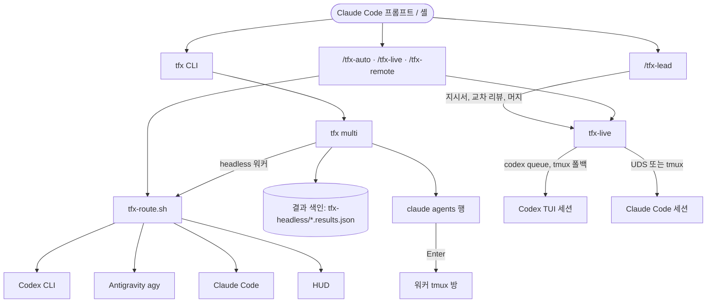

[English](README.md) | [한국어](README.ko.md)

<p align="center">
  <picture>
    <source media="(prefers-color-scheme: dark)" srcset="docs/assets/logo-dark.svg">
    <source media="(prefers-color-scheme: light)" srcset="docs/assets/logo-light.svg">
    
  </picture>
</p>

<h3 align="center">Claude Code · Codex · Antigravity를 잇는 CLI 중심 멀티모델 오케스트레이터</h3>

<p align="center">
  <a href="https://www.npmjs.com/package/triflux"></a>
  <a href="https://www.npmjs.com/package/triflux"></a>
  <a href="https://github.com/tellang/triflux/stargazers"></a>
  = 22">
  <a href="https://opensource.org/licenses/MIT"></a>
</p>

triflux는 코딩 작업을 Claude, Codex, Antigravity 사이에서 나눠 맡기는 Claude Code 플러그인이자
npm CLI다. `/tfx-auto`에 할 일을 한 번 적으면 triflux가 CLI 레인(기본은 Codex)을 고르고, 임의
셸 명령 대신 관리된 경로로 실행한다. 필요하면 로컬 병렬 워커, Claude↔Codex 라이브 세션, 원격 호스트로 작업을 나눈다.
코드 변경을 병렬로 진행할 때는 작업별 worktree와 세션을 분리한다. 설치, 진단, 팀 실행은 `tfx`
셸 CLI가 맡는다.

## 설치

```bash
npm install -g triflux   # postinstall이 setup 스크립트를 실행한다
tfx doctor               # CLI, tmux, MCP, 프로필, 스킬 점검
```

npm 12 이상은 기본적으로 설치 스크립트를 막는다. setup 스크립트를 허용해 설치한다.

```bash
npm i -g triflux --allow-scripts=triflux
```

기본 setup은 `triflux` 마켓플레이스를 등록하고 mods 설치 안내만 출력한다. 사용량 band와
서브에이전트 effort 강제 기능은 따로 설치한다(Claude Code 2.1.287 이상).

```bash
tfx setup --mods
```

이 저장소의 마켓플레이스에서 Claude Code 플러그인으로 설치할 수도 있다.

```bash
claude plugin marketplace add tellang/triflux
claude plugin install triflux@triflux
```

흔한 설정 어긋남은 `tfx doctor --fix`로 고친다. 자동화에서는 `tfx doctor --json`을 쓴다.

## 처음 써 보기

```text
/tfx-auto "깨지는 인증 테스트 고쳐줘"
/tfx-auto "이 변경에서 신뢰 경계 문제 리뷰해줘" --mode consensus
/tfx-auto "마이그레이션 끝내고 검증까지" --mode deep --retry ralph --max-iterations 10
```

## 스킬

직접 쓰는 스킬:

| 스킬 | 용도 |
| --- | --- |
| `/tfx-auto` | 구현, 수정, 리뷰, 병렬 작업의 진입점. 동작은 아래 플래그로 정한다. |
| `/tfx-live` | Claude↔Codex 라이브 세션. `start`/`ask`/`wait`/`stop`, `peer` 중계, `list-sessions`. |
| `/tfx-lead` | `/tfx-lead <역할>`로 세션에 개발 리드, 프로젝트 리드 같은 역할을 맡기고 이름을 바꾼다. 리드가 워커에 이름을 붙여 등록하고 컨텍스트, 지시서, 교차 리뷰, 머지·릴리스를 관리한다. 메모리 압박 알림은 `/tfx-pressure on\|off\|status`. |
| `/tfx-remote` | SSH 원격 Claude Code 세션 시작, 조회, 재부착, 메시지 전송, 준비 상태 확인, 모니터링, 종료. |
| `/tfx-setup` | 설정. 파일 동기화, HUD, Codex와 Antigravity 프로필, MCP. mods는 `tfx setup --mods`로 설치. |
| `/tfx-doctor` | 진단과 복구. |
| `/tfx-ship` | triflux 릴리즈 절차(메인테이너용). |
| `/tfx-wt` | Windows Terminal 탭·패인 조작. `tfx setup`은 Windows에만 설치한다. |

내부 레인(`internal: true`. 다른 스킬과 라우터가 부르지만 이름을 직접 불러도 된다):

| 스킬 | 용도 |
| --- | --- |
| `tfx-harness` | 메타 라우팅. 요청에 맞는 스킬이나 경로를 실행 없이 하나 골라 준다. |
| `tfx-review` | 코드 리뷰 판정(`--quick`은 가벼운 버전). |
| `tfx-research` | 출처를 교차 확인하는 웹 리서치(`--quick`, `--auto`, `--depth`). |

실행 계획은 superpowers `writing-plans`, 요구사항은 host `deep-interview`, 목표 변환은
Claude Code 기본 `/goal`을 쓴다. 다중모델 계획·실행은 `/tfx-auto --mode deep`으로 진행하고,
Codex 프로필은 `~/.codex/<프로필>.config.toml`에서 직접 관리한다.

## `/tfx-auto` 플래그

| 플래그 | 값 | 효과 |
| --- | --- | --- |
| `--mode` | `quick`(기본), `deep`, `consensus`, `live` | `deep` = 계획 → 실행 → 검증 루프, `consensus` = 여러 CLI 합의, `live` = `tfx-live peer`로 넘김 |
| `--shape` | `consensus`, `debate`, `panel` | `--mode consensus`의 결과 형태 |
| `--cli` | `auto`, `codex`, `antigravity`, `claude` | CLI 레인 고정 |
| `--cli-set` | `triad`, `no-antigravity`, `custom` | 합의 참여자 구성 |
| `--parallel` | `1`, `N` | `N` = 로컬 워커(`tfx multi`) |
| `--retry` | `0`, `1`(기본), `ralph`, `auto-escalate` | `ralph` = 막힘 감지가 있는 재시도 상태 기계, `auto-escalate` = 모델 체인을 한 단계씩 올림 |
| `--max-iterations` | `N` | `ralph`/`auto-escalate` 상한(`0`은 무제한) |
| `--rounds` | `N`(기본 4) | `--mode live` 왕복 횟수 |
| `--skill` | `<name>` | `skills/<name>/SKILL.md`를 Codex/Antigravity 프롬프트 앞에 붙임 |
| `--no-native-bridge-ui` | | headless 워커를 `claude agents` 패널에 띄우지 않음 |

`--lead`, `--options`, `--experts`와 플래그 충돌 규칙까지 포함한 전체 계약은
[`skills/tfx-auto/SKILL.md`](skills/tfx-auto/SKILL.md)에 있다.

## 모델과 프로필

Codex 가족 프로필은 `~/.codex/<가족>.config.toml`에 `model`만 기록한다. effort는 `-c model_reasoning_effort`로 별도 전달한다. 수동 CLI 예는 `codex -p sol -c 'model_reasoning_effort="high"'`이다. 역할별 가족과 effort는 [`scripts/lib/agent-route-policy.mjs`](scripts/lib/agent-route-policy.mjs)에서 정한다.

실행, setup, update 시 Codex와 Antigravity 가족 프로필을 사용 가능한 최신 버전으로 갱신한다. Codex는 로컬 모델 캐시를 읽고, Antigravity는 `agy models`의 Argon 결과를 하루 동안 캐시한다. 최신 모델이 요청 effort를 지원하지 않으면 지원하는 가장 가까운 아래 단계로 제한한다. 지원 목록이 없으면 요청값을 유지한다. Flash와 Pro는 자동 선택하지 않고, 옛 `flash*` 프로필 이름은 `argon` + `low`로 해석한다. Claude는 기존 별칭을 유지한다.

`~/.config/triflux/models.json`에 `{"sol":"gpt-6-sol","argon":"gemini-4-argon"}`처럼 적으면 가족별로 고정한다(Windows: `%APPDATA%\triflux`). 목록을 읽지 못하면 마지막 해석 결과, 그다음 내장 기본값을 쓴다.

| 가족 + effort / Claude 별칭 | 레인 |
| --- | --- |
| `astra` + `xhigh` | 아키텍처, 계획, 비평, 디버깅, 보안 리뷰, 깊은 실행 |
| `astra` + `max`, `astra` + `ultra` | 가장 어려운 단일 작업(`TFX_CODEX_PROFILE=max\|ultra`). `max`는 `auto-escalate` 첫 단계 |
| `sol` + `high` / `sol` + `medium` | 기본 구현, 리뷰, 검증, 테스트, 문서 / 정리 작업 |
| `terra` + `high` | 글쓰기, 문서 조사 |
| `luna` + `high` / `luna` + `low` | 빌드 수정 / 지연 우선 조회 |
| `argon` + `low` / `medium` / `high` | Antigravity 분류 / 생성 / 검토 |
| Claude `fable` | `--retry auto-escalate` 마지막 단계 |
| Claude `opus` / `sonnet` / `haiku` | 메타 라우팅과 계획 게이트 / Claude 네이티브 QA·검증 / 빠른 탐색 |

라우팅 정책: [`.claude/rules/tfx-routing.md`](.claude/rules/tfx-routing.md) ·
승격 체인: [`.claude/rules/tfx-escalation-chain.md`](.claude/rules/tfx-escalation-chain.md).

## 셸 CLI

| 명령 | 용도 |
| --- | --- |
| `tfx setup` / `tfx doctor` | 파일·HUD·MCP·프로필 동기화 / 진단과 복구(`--fix`, `--json`) |
| `tfx multi` | tmux 기반 로컬 멀티 CLI 팀 |
| `tfx mcp` | 관리형 MCP 레지스트리: `list`, `sync`, `add`, `remove` |
| `bash ~/.claude/scripts/tfx-route.sh code-reviewer "<지시>"` | 정책에 따라 `codex exec review`로 리뷰 전달 |
| `tfx list`, `tfx update`, `tfx version` | 설치된 스킬, 업데이트, 버전 |
| `tfx-live` | 라이브 세션 브리지(`/tfx-live` 스킬과 같은 명령) |

정확한 인자는 `tfx <명령> --help`로 확인한다.

## 런타임 기능

**라이브 세션.** `tfx-live`는 Claude Code와 Codex TUI 세션을 조종한다. Claude 데몬 대상
(`--short`/`--session-id`)은 UDS를 먼저 시도하고, `--session`도 주면 실패 시 tmux로 넘어간다.
Codex `ask`는 Codex 큐(app-server `thread/queue/add`)에 메시지를 쌓고(TUI에 `[from <보낸 세션>]` 첫 줄로 보인다) 못 쓰면 이유를
남기고 tmux로 보낸다. `--transport uds --thread <id|auto>`로 UDS도 쓸 수 있다. `peer`는 두 세션 사이를
`--rounds`만큼 중계한다. triflux의 Codex
훅이 실행 중인 Codex 세션을 `~/.local/state/triflux/codex-sessions/`에 기록하므로
`tfx-live list-sessions --cli codex|claude`로 직접 띄운 tmux 세션도 찾을 수 있다.

**오래 걸리는 작업.** `scripts/tfx-route.sh --async <agent> "<프롬프트>"`는 job id를 바로 돌려줘서
Claude Code Bash 도구의 600초 제한에 걸리지 않는다. 이후 `--job-status`, `--job-wait`,
`--job-result`로 확인한다.

**Headless 워커.** `tfx-auto`, `tfx multi`의 headless 워커는 `claude agents` 패널에 행으로 보인다.
행에서 Enter를 누르면 그 워커가 도는 tmux pane이 열린다. 끄려면 `--no-native-bridge-ui`를 준다.

**재시도와 승격.** `--retry ralph`는 끝나거나 막힐 때(같은 실패 3회 연속)까지 반복한다.
`--retry auto-escalate`는 Codex `astra` + `max`에서 Claude `fable`로 전환한다. 체인은
`.triflux/config/escalation-chain.json`으로 바꿀 수 있다.

**머신 프로파일.** setup은 이 머신에서 쓸 CLI와 timeout 정책을
`~/.config/triflux/machine-profile.env`에 기록한다. `TFX_DISABLE_CODEX=1`이나
`TFX_DISABLE_ANTIGRAVITY=1`을 주면 그 CLI가 라우팅에서 빠진다. 허용된 CLI가 하나도 없으면 조용히
다른 경로로 넘어가지 않고 실패한다. 자세한 내용은
[`.claude/rules/tfx-machine-profile.md`](.claude/rules/tfx-machine-profile.md).

**원격 호스트.** `/tfx-remote`는 `~/.config/triflux/hosts.json`
(Windows는 `%APPDATA%\triflux\hosts.json`)에서 호스트를 읽는다. 세션 시작은
`remote-spawn.mjs`의 `--host <host> --prompt "<요청>"` 옵션을 사용한다.
[실행 옵션](skills/tfx-remote/SKILL.md)을 따른다.

## 구조



패키지 구성과 실행 경로는 [ARCHITECTURE.md](ARCHITECTURE.md), 문서 지도는
[docs/README.md](docs/README.md)에 있다.

## 플랫폼

| 플랫폼 | 멀티플렉서 | 참고 |
| --- | --- | --- |
| macOS | tmux | 기본 경로. hard ceiling을 양수로 두면 `coreutils`(`gtimeout`)가 필요하다. |
| Linux | tmux | 지원. |
| Windows | psmux + Windows Terminal | 아래 참고. |

**Windows.** psmux(tmux 포크)의 기본 셸은 PowerShell이다. `wt.exe`와 psmux `kill-session`은 직접 호출하지
않고, 탭과 패인은 `tfx-wt` 스킬(Windows에만 설치)과
`hub/team/wt-manager.mjs`를 거친다. 에이전트 규칙은
[`.claude/rules/tfx-psmux.md`](.claude/rules/tfx-psmux.md).

## 보안과 가드

| 층 | 보호 |
| --- | --- |
| 관리된 경로 | Codex와 Antigravity는 `tfx-route.sh`, headless 워커, `tfx`로만 부르고 맨 `codex exec`나 `agy`로 부르지 않는다. 호출자가 지키는 규칙이며 이를 막는 훅은 없다. |
| MCP 레지스트리 | 낡았거나 지원하지 않는 MCP 항목을 관리형 항목으로 바꾼다. |
| 합의 결과 | deep·consensus 실행은 일부 레인이 빠졌거나 의견이 갈린 결과를 숨기지 않고 표시한다. |

### Jev 데이터 전송 정책

Jev는 `JEV_API_KEY` 또는 `TYPESAFE_API_KEY`를 설정하거나, `TFX_JEV_CLI` 경로를
명시하거나, Jev CLI를 찾을 수 있는 환경에서 `TFX_JEV=1`을 설정할 때 활성화된다.
내장 판정 함수는 API 키가 있으면 외부 Jev HTTP 서비스로 입력을 보내고, 그렇지 않으면
설정된 CLI의 인자로 전달한다.

작업 프롬프트와 지시는 길이를 제한하기 전에 sanitizer로 보호하고 HTTP 또는 CLI 전송
경계에서 다시 검사한다. 내장 함수의 상한은 작업 라우팅 1,400자, MCP 작업 선택 1,200자,
작업 중 개입과 세션 선택 1,000자, 하위 작업 배정 800자, 주입한 지시 600자, 입력창의
예상 프롬프트 접두사 200자다. 일반 stdout, stderr, rollout, worker 출력과 TUI 캡처는
문자 수, 줄 수, 진행 여부, 입력 대기 여부, 오류 여부 같은 메타데이터만 보낸다.

실패 원인이나 peer 응답의 의미 발췌는 `judgeSameFailureCause`와
`judgePeerConvergence`에만 허용한다. 원인과 응답은 각각 한 줄 전체가 600자 이하여야
하고, 선택적으로 전달하는 peer 과제는 500자 이하여야 한다. 길이는 JavaScript 문자열
길이인 UTF-16 코드 단위로 센다. 긴 로그에서 일부 줄을 고르지 않으며 발췌를 자르거나
공백을 정규화하지 않는다. 빈 입력, 길이 초과, 여러 줄, 제어 문자, 구조가 로그처럼 보이는
입력은 거절한다. sanitizer가 발췌, peer 과제, 결합한 전송 문맥을 조금이라도 변경하면 client, HTTP,
CLI를 호출하기 전에 `null`을 반환한다. 변경된 입력을 모두 거절하므로 서로 다른 원문이
보호 후 같은 발췌로 합쳐지는 경우도 확정 판정에 쓰지 않는다. 거절된 비교는 STUCK이나
peer 조기 종료에 Jev의 확정 근거를 더하지 않고 기존 결정적 제어를 유지한다.

sanitizer는 자격 증명 대입, Bearer 토큰, private key 같은 패턴을 처리한다. 정규식으로
모든 형태의 비밀을 제거한다고 보장할 수는 없다. `TFX_JEV=0`을 설정하면 키나 CLI가
있어도 Jev를 끌 수 있으며, 민감한 작업에서는 비활성 상태를 유지한다.

### 선택적 native peer 어댑터

`triflux setup`에서 명시적으로 동의하면 로컬 Claude·Codex 피어용 `~/.claude/scripts/tfx-peer send` 래퍼만 승인하고 Bash 전체 권한이나 sandbox를 완화하지 않는다. `~`는 셸 예시이며 Codex 규칙은 setup이 출력한 실제 절대경로에 맞고, Claude의 `written`은 UDS 쓰기만 뜻하며 Codex의 `agent_message`도 모델 완료를 보증하지 않는다. 설치 신뢰 조건, 재시도와 allow·rule·래퍼·동의 manifest 철회 절차는 [tfx-live 스킬](skills/tfx-live/SKILL.md#선택적-전역-native-peer-어댑터)에 둔다.

## 기여

Node 22 이상이 필요하다. 테스트, 린트, 패키지 경계, 미러·릴리즈 점검, 상태 스냅샷은
[CONTRIBUTING.md](CONTRIBUTING.md)에 있다. 릴리즈는 자동이다. 버전을 올린 커밋이 `main`에
머지되면 CI 통과 뒤 `release.yml`이 태그, GitHub 릴리즈, OIDC Trusted Publishing을 통한 npm 게시까지 진행한다.
결정 기록은 [docs/adr/](docs/adr/README.md)에 있다.

<p align="center">
  <sub>MIT License &middot; Made by <a href="https://github.com/tellang">tellang</a></sub>
</p>
