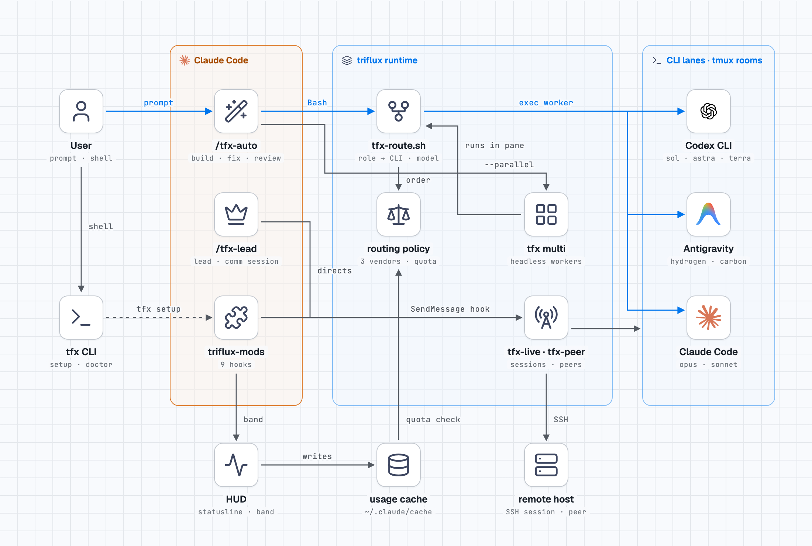
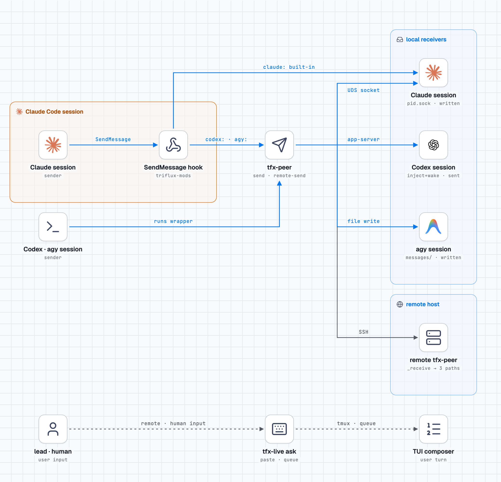

[English](README.md) | [한국어](README.ko.md)

<p align="center">
  <picture>
    <source media="(prefers-color-scheme: dark)" srcset="docs/assets/logo-dark.svg">
    <source media="(prefers-color-scheme: light)" srcset="docs/assets/logo-light.svg">
    
  </picture>
</p>

<h3 align="center">A CLI orchestrator for running Claude Code, Codex, and Antigravity together</h3>

<p align="center">
  <a href="https://www.npmjs.com/package/triflux"></a>
  <a href="https://www.npmjs.com/package/triflux"></a>
  <a href="https://github.com/tellang/triflux/stargazers"></a>
  = 22">
  <a href="https://opensource.org/licenses/MIT"></a>
</p>

## Purpose

triflux is a Claude Code plugin plus an npm CLI. It does three things.

- Task routing: for each role (implementation, review, design, and so on) it picks Codex CLI, Antigravity CLI (`agy`), or Claude Code, plus a model and effort, and runs the work.
- Session control: it starts, queries, compacts, and stops Claude, Codex, and agy sessions running in tmux, and lets those sessions message each other.
- Lead workflow: one session acts as a lead that registers other sessions as workers and manages briefs, cross review, and merges.

## Architecture

<picture>
  <source media="(prefers-color-scheme: dark)" srcset="https://raw.githubusercontent.com/tellang/triflux/main/docs/assets/architecture-en-dark.png">
  
</picture>

- `/tfx-auto` runs `tfx-route.sh` through Bash inside Claude Code.
- `tfx-route.sh` gets a per-role candidate order from the routing policy module and runs the first candidate CLI as a non-interactive worker.
- The routing policy reads the usage cache written by the HUD and drops vendors that hit their limits.
- `tfx multi` creates worker panes in a tmux room. In headless runs each pane runs `tfx-route.sh`, and Claude workers run `claude --print`. Interactive runs start each CLI's TUI in its pane and type the prompt.
- `tfx-live` and `tfx-peer` control interactive sessions. Message paths are under "Sessions and peer messages" below.

## Requirements

- Node.js 22 or later
- tmux on macOS and Linux; psmux and Windows Terminal on Windows
- The CLIs you want to use: Codex CLI, Antigravity CLI (`agy`), Claude Code. Setup records which ones this machine uses in a machine profile.
- triflux-mods: Claude Code 2.1.287 or later

## Install

```bash
npm install -g triflux --allow-scripts=triflux   # npm 12+ blocks install scripts unless allowed
tfx setup                                        # interactive setup
tfx doctor                                       # health check
```

- postinstall runs `scripts/setup.mjs`, which installs scripts, the HUD, skills, Codex profiles, and the machine profile, and registers Codex hooks.
- postinstall and CI skip every prompt and only print hints. mods, the agy plugin, lead launch commands, the peer adapter approval, Codex hook trust, tmr, and psmux on Windows are offered only by an interactive `tfx setup`.
- `tfx setup --mods` installs mods and the agy plugin without asking.
- The Claude Code marketplace works too:

```bash
claude plugin marketplace add tellang/triflux
claude plugin install triflux@triflux
claude plugin install triflux-mods@triflux
```

- `tfx update` detects how triflux was installed (plugin, npm, git), updates it, and runs the new version's setup.

## First run

```text
/tfx-auto "fix the failing auth tests"
/tfx-auto "review this change for trust-boundary issues" --mode consensus
/tfx-auto "finish the migration and verify it" --mode deep --retry ralph --max-iterations 10
```

## Running tasks

### `/tfx-auto` flags

| Flag | Values | Effect |
| --- | --- | --- |
| `--mode` | `quick` (default), `deep`, `consensus`, `live` | `deep` loops plan, execute, verify. `consensus` merges several CLIs. `live` runs `tfx-live peer` between two sessions |
| `--shape` | `consensus`, `debate`, `panel` | Output shape for `--mode consensus` |
| `--cli` | `auto`, `codex`, `antigravity`, `claude` | Moves that vendor to the front. Claude-native roles such as explore change only with `--no-claude-native` |
| `--cli-set` | `triad`, `no-antigravity`, `custom` | Which CLIs join a consensus |
| `--parallel` | `1`, `N` | `N` runs through `tfx multi`. Two or more code-changing tasks get one worktree and session each |
| `--retry` | `0`, `1` (default), `ralph`, `auto-escalate` | See "Retry and escalation" |
| `--max-iterations` | `N` | Iteration cap for `ralph`, per-stage cap for `auto-escalate`. Default `0` means no cap |
| `--rounds` | `N` (default 4) | Round trips for `--mode live` |
| `--skill` | `<name>` | Prepends `skills/<name>/SKILL.md` to Codex and agy prompts |
| `--no-native-bridge-ui` | | Keeps headless workers out of the `claude agents` list |

The full contract is in [`skills/tfx-auto/SKILL.md`](skills/tfx-auto/SKILL.md).

### Candidate order by role

`tfx-route.sh <role> "<instruction>"` takes its candidate list from [`scripts/lib/vendor-priority-policy.mjs`](scripts/lib/vendor-priority-policy.mjs). Defaults:

| Role | 1st | 2nd | 3rd |
| --- | --- | --- | --- |
| Implementation, tests, verification | Codex `sol` high | agy `hydrogen` | Claude `sonnet` |
| Build fixes, cleanup | Codex `sol` medium | agy `hydrogen` low | Claude `sonnet` low |
| Architecture, planning, critique, debugging | Claude `opus` high | Codex `astra` xhigh | agy `carbon` high |
| Deep execution | Claude `opus` high | Codex `astra` ultra (max inside workers) | agy `carbon` high |
| Code review (Codex author) | Claude `opus` high | agy `hydrogen` high | Same vendor in a fresh session |
| Security review | Claude `fable` high | Codex `astra` xhigh | agy `carbon` high |
| Writing, research | agy `hydrogen` medium | Claude `opus` | Codex `terra` high |
| Design | Claude `opus` high | agy `hydrogen` high | Codex `sol` high |
| Exploration | Claude `haiku` low | Codex `luna` low | agy `hydrogen` low |

- Code review drops the vendor that wrote the code. `TFX_REVIEW_AUTHOR` names it and defaults to Codex. With a Claude author the first candidate is Codex `sol` high.
- Vendors disabled with `TFX_DISABLE_CODEX`, `TFX_DISABLE_ANTIGRAVITY`, or `TFX_DISABLE_CLAUDE`, vendors that are not installed, and vendors at 100% usage or in cooldown are removed.
- A vendor above 95% of its 5-hour or weekly limit moves back one slot.
- With Jev enabled and confidence at 0.85 or higher, two adjacent candidates may swap once.
- If no candidate is left, routing exits with code 78 instead of silently switching paths.
- A quota or 429 error at run time reroutes to the next candidate, at most twice. Auth failures, context overflow, and safety refusals do not reroute.

### Model families and effort

- Codex families are `astra`, `sol`, `terra`, and `luna`. `~/.codex/<family>.config.toml` stores only `model`; effort is passed with `-c model_reasoning_effort`.
- agy families are `hydrogen`, `carbon`, `neon`, and `argon`. Defaults use `carbon` and `hydrogen`; `argon` is used only when named ([ADR-0055](https://github.com/tellang/triflux/blob/main/docs/adr/0055-agy-drop-argon-add-neon.md)).
- Each family resolves to its newest model at run time, from `~/.codex/models_cache.json` for Codex and a daily `agy models` lookup for agy.
- If a model does not support the requested effort, the nearest lower supported level is used.
- `~/.config/triflux/models.json` pins a family, for example `{"sol":"<model id>"}`.

### Retry and escalation

- `--retry 1` repeats verify and fix up to three times on the same CLI.
- `--retry ralph` repeats until done. Three consecutive failures with the same cause stop it as STUCK.
- `--retry auto-escalate` needs a positive `--max-iterations N`; it then tries each stage N times before moving on. With the default `0` it never escalates and only the STUCK rule applies. Three failures with the same cause end the run as STUCK even before the cap.
- The default chain has three stages: Codex `astra` max, agy `carbon` high, Claude `fable` high. Stages for disabled or missing vendors are skipped.
- `.triflux/config/escalation-chain.json` sets a per-project chain.

### Parallel runs and the results index

- `tfx multi` runs headless when called non-interactively (Claude Code's Bash tool, a pipe, CI).
- Headless workers still run in tmux rooms, so a multiplexer is required.
- Each headless run writes worker status, exit code, and output paths to `$TMPDIR/triflux-<uid>/tfx-headless/<session>.results.json` (`%TEMP%\tfx-headless\` on Windows). Read results from this file, not from screen text.
- On macOS and Linux each worker gets a row in `claude agents`. Pressing Enter on a row attaches read-only to the worker pane.
- For a single long task, `tfx-route.sh --async <role> "<instruction>"` returns a job id; check it with `--job-status`, `--job-wait`, `--job-result`. This avoids the Bash tool's 600-second limit.

## Sessions and peer messages

<picture>
  <source media="(prefers-color-scheme: dark)" srcset="https://raw.githubusercontent.com/tellang/triflux/main/docs/assets/peer-en-dark.png">
  
</picture>

A peer message reaches the receiving session's model as a message from another agent. `tfx-live ask` is different: it types into the receiver's input box as a user turn.

### Sending

- Claude sessions on the same machine use Claude Code's built-in `SendMessage`.
- Claude also uses `SendMessage` to reach Codex or agy. With `to` set to `codex:<name>` or `agy:<name>`, triflux-mods hands the message to `tfx-peer send`. Bodies that are a whole JSON object or array are not relayed. `ListAgents` lists `codex:` and `agy:` sessions as well.
- Codex and agy sessions run the wrapper `~/.claude/scripts/tfx-peer`. It is installed only on macOS and Linux, when you accept the peer adapter approval in an interactive `tfx setup`.

```bash
"$HOME/.claude/scripts/tfx-peer" send --to 'codex:11.26 impl' --message 'send me a summary of the change'
"$HOME/.claude/scripts/tfx-peer" send --to 'claude:11.26 lead' --message 'results are in out/report.md'
```

### Transport per target

| Target | Transport | Success status |
| --- | --- | --- |
| Claude | Writes a `<cross-session-message>` frame to the session's messaging UDS socket (a named pipe on Windows) after token auth | `written` |
| Codex | Sends JSON-RPC `thread/inject_items` (agent_message) over the shared Codex app-server daemon's UDS, then `turn/start` | `sent` |
| agy | Writes a message file into the conversation's `.system_generated/messages/` | `written` |

- The first line is `[tfx-peer from=<cli>:<name> msg=<id>]` and the last line is a reply command.
- Bodies are limited to 8000 characters. A body over 4000 characters sent to a lead is cut to its first 800 characters plus up to 20 file paths when it names files. Codex and agy targets count only files that exist; for Claude targets the receiver's mods do the cut. Without paths it is sent whole with a warning.
- `written` and `sent` confirm only the write and the turn start. They do not mean the model read the message or finished the work.
- `partial` and `unknown` may already have been delivered, so they are never resent automatically. Failures never fall back to tmux input.
- A Codex target must be attached to the shared daemon through `tfx-live start`. A Codex you started yourself on the shared daemon can be recorded with `tfx-live adopt`; one started outside the daemon (`--no-daemon` or `-c` overrides) must be restarted with `tfx-live start --resume`.
- An idle agy session wakes immediately only with the `peer-wake` patch. Without it, use `tfx-live ask`.

### Remote peers

```bash
"$HOME/.claude/scripts/tfx-peer" remote-send --host m5 --reply-host m2 --to 'codex:11.26 impl' --message 'please check'
```

- One SSH call passes a JSON message (up to 64 KiB) to the fixed entry point `tfx-peer _receive`, which delivers it through the same three transports.
- `--host` is the destination. `--reply-host` is this machine's alias that the receiver uses to reply. Each side needs the other host in its `hosts.json`. The path is `~/.config/triflux/hosts.json` on macOS and Linux or `%APPDATA%\triflux\hosts.json` on Windows.
- The destination must be macOS or Linux. A Windows host can send but cannot receive, so it gets no reply; register it with `"os": "windows"` on the receiver. The result is one of `rejected`, `written`, `sent`, `partial`, `unknown`.

### User input path

`tfx-live ask` enters text as the receiver's user turn. Use it for remote sessions, slash commands, and the first instruction to a new agy session.

- Codex: the default is the app-server queue (`thread/queue/add`). Slash commands, `--if-busy fail|interrupt|auto`, and remote sessions use tmux input. When the queue is unavailable it falls back to tmux and reports `fallbackReason`.
- Claude: background daemon sessions go through the daemon control socket; others get tmux `paste-buffer` input.
- agy: tmux `paste-buffer` input.
- `tfx-live send` between local sessions returns `use-tfx-peer` with the matching `tfx-peer send` command, or `use-send-message` from Claude to Claude. `--via-tmux` forces tmux input.
- `tfx-live peer --rounds N` relays `ask` back and forth between two sessions up to N times, ending early when Jev judges that they converged. It is unrelated to `tfx-peer`.

## Lead and communication sessions

- `tfx lead <role>` starts a lead session in tmux. With `--cli auto` (default) the candidates are Claude `opus` high, Codex `astra` xhigh, agy `carbon` high. The session is named `<folder>-lead`.
- `--role communication` starts a session that talks with people and collects decisions. Candidates are Claude `opus` medium, agy `hydrogen` medium, Codex `terra` high, and the session is named `<folder>-comm`. Procedure: [`skills/tfx-comm/SKILL.md`](skills/tfx-comm/SKILL.md).
- In a running Claude session, `/tfx-lead <role>` makes it the lead: it renames the session, turns on memory pressure monitoring, and loads the `tfx-lead` skill.
- The lead uses the mods tool `tfx_control` to compact, clear, or exit itself and its workers. agy targets do not support compact, and exit for the lead itself or a peer-path Claude needs a handoff file. A Claude worker outside tmux accepts it only if the lead started it with `--lead-session`.

### triflux-mods features

| Feature | Behavior |
| --- | --- |
| Usage band | In the default `above` position, shows the HUD above the input box every 60 seconds. Sends one succession notice when the lead's context reaches 85% |
| Subagent effort | Applies a fixed effort per agent type unless the caller sets one |
| Peer messages | Hands `SendMessage` targets `codex:` and `agy:` to `tfx-peer` |
| Memory pressure | `/tfx-pressure on\|off\|status`. Reads the macOS kernel pressure level every 2 seconds and notifies the lead at critical |
| Lead marker | Marks sessions started with `/tfx-lead` or `tfx lead` as leads |
| `tfx_control` | compact, clear, exit, whoami, rebind for lead sessions |
| Compact snapshot | Appends a status block of up to 2000 characters to compact instructions; for leads it holds role, handoff file, worker table, open PRs, and remaining work |
| Report length | Cuts peer messages and subagent results over 4000 characters sent to the lead to a head plus file paths, when they name files |
| Idle teammates | Flags teammates idle for 10 minutes and asks them to shut down 10 minutes later. `/tfx-keep <name>` exempts one |

## Skills

| Skill | Purpose | Installed for |
| --- | --- | --- |
| `/tfx-auto` | Entry point for building, fixing, reviewing, and parallel work | Claude |
| `/tfx-live` | Session control and peer messages for Claude, Codex, agy | Claude, Codex, agy |
| `/tfx-lead` | Lead role, worker registry, cross review, merge and release | Claude, Codex, agy |
| `/tfx-comm` | Communication session: talking with people, decision tables, reports | Claude, Codex, agy |
| `/tfx-harness` | Picks one skill or path for a request without running it | Claude, Codex |
| `/tfx-review` | Code review verdicts | Claude |
| `/tfx-research` | Web research with cross-checked sources | Claude |
| `/tfx-remote` | Start, list, attach, and stop remote Claude Code sessions over SSH | Claude |
| `/tfx-setup`, `/tfx-doctor` | Setup and diagnostics | Claude |
| `/tfx-ship` | triflux release procedure (maintainers) | Claude |
| `/tfx-wt` | Windows Terminal tabs and panes | Claude (Windows) |

agy skills are installed only when `agy` is on PATH.

## Shell commands

| Command | Purpose |
| --- | --- |
| `tfx setup [--dry-run] [--mods]` | Sync files, skills, HUD, profiles |
| `tfx doctor [--fix] [--json]` | Diagnose and repair. Also `--audit`, `--diagnose`, `--reset`, `--purge-logs`, `--cleanup-stale-tmux` |
| `tfx update`, `tfx list`, `tfx version` | Update, installed skills, version |
| `tfx lead <role>` | Start a lead or communication session |
| `tfx multi` | Multi-CLI team runs: `start`, `status`, `send`, `attach`, `stop`, and more |
| `tfx judge route\|worker-mode\|worker-model` | Print a routing decision as JSON without starting a session |
| `tfx mcp list\|catalog-refresh` | List Claude and Codex MCP servers; refresh the public catalog cache. Installs nothing |
| `tfx-live <verb>` | `start`, `ask`, `wait`, `queue`, `send`, `compact`, `clear`, `goal`, `rename`, `adopt`, `interrupt`, `stop`, `probe`, `list-sessions`, `inspect`, `reconcile`, `peer` |
| `tfx-peer send\|remote-send` | Send peer messages |
| `bash ~/.claude/scripts/tfx-route.sh <role> "<instruction>"` | Run one worker under the routing policy |

Run `<command> --help` for arguments.

## HUD

- The Claude Code statusline shows Claude, Codex, and agy usage on `c:`, `x:`, and `a:` rows. Claude and Codex rows show 5-hour and weekly usage with reset times; the agy row shows usage and whatever reset data agy reports, without separate windows.
- Context shows as `ctx:NN%`, or `ctx:--` when unknown. A `j` marks Jev as configured; it does not mean authentication succeeded.
- tmux sessions started with `tfx-live start --cli codex` show the same HUD in a three-line tmux status bar.
- Sources: Claude statusline input (or the OAuth usage API), Codex rollouts and an app-server probe, and `agy -p /usage` (Cloud Monitoring metrics when agy has a GCP project configured). Results are cached in `~/.claude/cache/`, which the routing policy reads.
- Rows for CLIs disabled in the machine profile are hidden.

## Config files

| File | Contents |
| --- | --- |
| `~/.config/triflux/machine-profile.env` | CLIs used on this machine, multiplexer, hard ceiling, stall policy |
| `~/.config/triflux/models.json` | Per-family model pins |
| `~/.config/triflux/hosts.json` | Remote hosts |
| `~/.config/triflux/lead.json` | Lead launch command per CLI |
| `~/.config/triflux/jev.json` | Jev settings |
| `.triflux/config/escalation-chain.json` | Per-project escalation chain |

`machine-profile.env`, `models.json`, and `lead.json` use `%APPDATA%\triflux` on Windows and honor `XDG_CONFIG_HOME`. `hosts.json` is under `~/.config/triflux/` (`%APPDATA%\triflux\` on Windows) and can be moved with `TFX_HOSTS_USER_STATE`; `jev.json` is under `XDG_CONFIG_HOME` or `~/.config/triflux/`. Machine profile keys are in [`.claude/rules/tfx-machine-profile.md`](https://github.com/tellang/triflux/blob/main/.claude/rules/tfx-machine-profile.md).

## Platforms

| Platform | Multiplexer | Limits |
| --- | --- | --- |
| macOS | tmux | None. A positive hard ceiling uses `gtimeout` from `coreutils` and only warns if it is missing |
| Linux | tmux | No memory pressure monitoring |
| Windows | psmux, Windows Terminal | Local peer messages to Claude targets only; remote peers send only. No `claude agents` rows or memory pressure monitoring |

psmux on Windows defaults to PowerShell. Tabs and panes go through the `tfx-wt` skill and [`hub/team/wt-manager.mjs`](hub/team/wt-manager.mjs).

## Security

- By convention Codex and agy run only through `tfx-route.sh`, headless workers, and `tfx` commands. No hook enforces this.
- Codex exec workers and TUIs launched by triflux get `--dangerously-bypass-hook-trust` by default, so active hooks can run without a prior review. `tfx-live start --cli codex` on the shared daemon sets `features.hooks=false` per new thread instead of passing the flag. Turn it off with `TFX_CODEX_BYPASS_HOOK_TRUST=0` or `--no-bypass-hook-trust`.
- The peer adapter approval is installed only when you agree during an interactive `tfx setup`. It adds one Claude allow entry, `Bash(<absolute path>/tfx-peer send:*)`, and the Codex rule file `~/.codex/rules/triflux-native-peer.rules`. `remote-send` is not covered. Revocation steps are in [`skills/tfx-live/references/peer-adapter.md`](skills/tfx-live/references/peer-adapter.md).

### Jev data transfer

Jev is an optional external service that triflux asks for decisions such as routing, mid-task intervention, and session selection.

- It turns on with `JEV_API_KEY` or `TYPESAFE_API_KEY`, `TFX_JEV_CLI`, `TFX_JEV=1` with `jev` (or `jev-cli`, `jevctl`) on PATH, or a `jev.json` with `enabled: true`. `TFX_JEV` set to `0`, `false`, or `off` turns it off regardless.
- `jev.json` must be owned by the current user and not writable by others. The key file it names must be an absolute path owned by the current user with mode `0600`. Only `KEY=VALUE` lines are read; nothing is executed by a shell.
- With an API key, requests go over HTTP; otherwise they go to the Jev CLI as arguments. On failure the built-in rules decide.
- A sanitizer masks private keys, Bearer tokens, and credential assignments before sending. It is regex-based and cannot guarantee that every secret is removed.
- Input limits per decision: task routing 1,400 characters, MCP selection 1,200, mid-task intervention, session selection, and skill branch 1,000 each, worker mode 1,000, worker mode 1,000, subtask assignment 800, instruction acknowledgment 600, composer prefix 200.
- stdout, stderr, rollouts, and TUI captures are sent only as metadata such as length, line count, and error flags.
- Task descriptions are sent within the limits above; for example the worker mode decision sends the whitespace-normalized task description, up to 1,000 characters.
- Raw excerpts of failure logs or peer replies go only to the same-failure-cause and peer-convergence decisions. Each must be one line of at most 600 characters, and it is not sent at all if the sanitizer changes anything.
- Keep `TFX_JEV=0` for sensitive work.

## Contributing

Tests, lint, package mirrors, and release checks are in [CONTRIBUTING.md](https://github.com/tellang/triflux/blob/main/CONTRIBUTING.md). When a version-bump commit lands on `main` and CI passes, `release.yml` tags, creates the GitHub release, and publishes to npm through OIDC Trusted Publishing. Design decisions are in [docs/adr/](https://github.com/tellang/triflux/blob/main/docs/adr/README.md); internals are in [ARCHITECTURE.md](https://github.com/tellang/triflux/blob/main/ARCHITECTURE.md).

<p align="center">
  <sub>MIT License &middot; Made by <a href="https://github.com/tellang">tellang</a></sub>
</p>