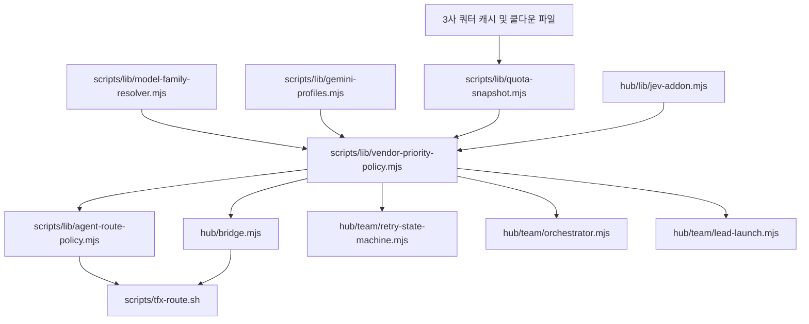

# 역할군별 3사 모델 우선순위 라우팅 및 Jev 연동 설계

## 목적

[ADR-0054](../adr/0054-multi-vendor-priority-routing.md)에서 확정한 역할군별 3사(Claude, Codex, Antigravity) 모델 우선순위 라우팅, 읽기 전용 쿼터 스냅샷 연동, Jev 최대 1칸 조정 규칙을 코드로 구현하기 위한 모듈 경계, 데이터 스키마, 의사결정 알고리즘, 에지 케이스, 기존 환경변수 호환성, 테스트 및 패키지 미러 대상을 명세한다.

## 아키텍처 개요와 모듈 경계

기존 시스템은 `hub/team/agent-map.json`에 역할별 단일 벤더만 적고, `scripts/tfx-route.sh`, `hub/team/retry-state-machine.mjs`, `hub/team/orchestrator.mjs`가 각자 다른 폴백 규칙을 실행했다. 신규 구조는 `scripts/lib/` 아래 두 모듈에 쿼터 읽기와 후보 우선순위 계산을 집중시키고 모든 실행 진입점이 같은 후보 배열을 소비하게 만든다.



모듈별 책임과 수정 범위는 다음과 같다.

- `scripts/lib/quota-snapshot.mjs` (신규): Claude, Codex, Antigravity 캐시 파일과 런타임 리셋 시각 파일을 동기 읽기 전용으로 파싱해 벤더별 사용률, 리셋 시각, 쿨다운 여부를 반환한다. 외부 프로세스 호출이나 네트워크 요청을 수행하지 않는다.
- `scripts/lib/vendor-priority-policy.mjs` (신규): 3사 4등급 모델표, 6개 역할군 및 세부 역할별 기본 벤더 순서, 쿼터 필터와 95% 초과 1칸 후순위 이동, Jev 고신뢰(`>=0.85`) 1칸 인접 교환, 환경 오버라이드 결합을 단일 순수 함수로 계산한다.
- `scripts/lib/model-family-resolver.mjs` (수정): `AGY_FAMILY_PROFILES`에 `hydrogen_low`, `hydrogen`, `hydrogen_high`를 추가해 `AGY_FAMILIES`와 `AGY_CACHE_KEY`를 갱신하고 목록 부재 시 `argon` 폴백 안전장치를 보강한다.
- `scripts/lib/gemini-profiles.mjs` (수정): `GEMINI_PROFILE_BY_PURPOSE`를 역할군 등급에 맞춰 `carbon_high`, `hydrogen_high`, `hydrogen`, `hydrogen_low`, `argon`으로 재배치한다.
- `scripts/lib/agent-route-policy.mjs` (수정): `CODEX_AGENT_POLICY`, `resolveClaudeWorkerDefaults`, `resolveWorkerModel`, `resolveAgentRoute`가 `vendor-priority-policy.mjs`의 후보 배열과 등급표를 정본으로 읽게 연결하고, 기존 `\x1e` 14필드 뒤에 15번째 필드로 직렬화된 후보 JSON을 덧붙인다.
- `hub/bridge.mjs` (수정): `cmdJudgeRoute`에서 Jev 판정 결과(`vendorAdjustment`)를 받아 초기 후보 배열에 최대 1칸 인접 교환을 적용하고 최종 선택 CLI 기준으로 `resolveWorkerModel`을 계산하며, `buildRetryCliInvocation`을 `codex`, `antigravity`, `claude` 3사 모두 지원하도록 확장한다.
- `hub/team/agent-map.json` (수정): 각 역할의 기본 1순위 벤더를 새 역할군 1순위와 일치시키고 `lead`, `communication`, `communication-relay`, `communication-report` 키를 추가한다.
- `scripts/tfx-route.sh` (수정): 초기 우선순위 후보 선택(`resolve_priority_route`), `apply_jev_pre_route`의 Jev 인접 교환 반영, `apply_retry_snapshot_cli_invocation`의 3사 승격 스냅샷 소비, `auto_reroute`의 후보 배열 순회, 비전환 오류(인증, 컨텍스트 초과, 정책 거부) 차단과 `TFX_DISABLE_CLAUDE`를 통합한다.
- `hub/lib/jev-addon.mjs` (수정): `COMPLEXITY_ROUTE_MAP`을 4등급표에 맞춰 교정하고 `judgeTaskRouting`에 작업 특성 및 분해 가능성 신호를 추가하며 `judgeTaskAssignment`의 벤더 설명과 후보 필터를 동기화한다.
- `hub/team/retry-state-machine.mjs` (수정): `DEFAULT_ESCALATION_CHAIN`을 최상 등급 3사 체인으로 정렬하고 가용성 검사를 `vendor-priority-policy.mjs`와 공유한다.
- `hub/team/orchestrator.mjs`, `hub/team/lead-launch.mjs`, `hub/team/iterm-layout.mjs` (수정): `lead`와 소통 역할 2종의 벤더 후보 연결, 대화형 상단 슬롯 구분, 워커 압축 요약 전달 계약을 반영한다.

`scripts/lib/` 하위 신규 모듈은 `packages/core`에 그대로 미러되므로(`CORE_ENTRIES` 포함), `CORE_ENTRIES` 바깥 모듈을 상대 경로로 import하지 않는다.

## 3사 모델 4등급표와 Hydrogen 가족 해석

### 수치 기준 모델 등급표

상수 `MODEL_TIERS`와 `TIER_RANK`(`{ low: 1, mid: 2, high: 3, top: 4 }`)는 `scripts/lib/vendor-priority-policy.mjs`에서 export한다.

| 등급 ID (`tier`) | 순위값 | Claude 모델 별칭 | Codex 가족 (`CODEX_FAMILY_PROFILES`) | Antigravity 가족 (`AGY_FAMILY_PROFILES`) |
|---|---:|---|---|---|
| `top` (최상) | 4 | `fable` (Fable 5.2), `opus` (Opus 5.5) | `astra` (`astra_xhigh`, `astra_max`, `astra_ultra`) | `carbon` (`carbon_low`, `carbon`, `carbon_high`) |
| `high` (상) | 3 | `sonnet` (Sonnet 5.5) | `sol` (`sol_med`, `sol_high`) | `hydrogen` (`hydrogen_low`, `hydrogen`, `hydrogen_high`) |
| `mid` (중) | 2 | - | `terra` (`terra_high`) | `argon` (`argon_low`, `argon`, `argon_high`) |
| `low` (하) | 1 | `haiku` (Haiku 5.5) | `luna` (`luna_low`, `luna_high`) | `hydrogen` (`hydrogen_low`, 탐색 경량 슬롯) |

등급 운영 규칙은 다음과 같다.

- `fable`은 기본 구현이나 일반 판단의 1순위에 두지 않고 `security-reviewer` 1순위, 계획 검증 게이트(`TFX_PLAN_REVIEW_GATE=1`), 재시도 승격 체인(`retry-state-machine.mjs`) 최종 단계에만 배치한다.
- Antigravity에는 별도의 하 등급 전용 가족을 두지 않고 빠른 응답(AA 작업 시간 1.5분 수준)과 낮은 쿼터 소모를 보이는 `hydrogen_low`를 탐색과 상태 중계 소통의 3순위 후보로 배치한다.
- `CODEX_TIER_LADDER`(`scripts/lib/agent-route-policy.mjs`)는 `["luna_low", "luna_high", "terra_high", "sol_med", "sol_high", "astra_xhigh"]` 순서로 유지하되 일반 구현의 `lower`/`raise` 이동이 `terra_high`(글쓰기 전용 레인)로 잘못 빠지지 않도록 코드 역할 이동 목록 `["luna_low", "luna_high", "sol_med", "sol_high", "astra_xhigh"]`를 유지한다.

### Antigravity Hydrogen 추가와 폴백 규칙

`scripts/lib/model-family-resolver.mjs`의 `AGY_FAMILY_PROFILES`에 다음 세 항목을 추가한다.

```js
hydrogen_low: {
  family: "hydrogen",
  effort: "low",
  model: "Gemini 4 Hydrogen (Low)",
},
hydrogen: {
  family: "hydrogen",
  effort: "medium",
  model: "Gemini 4 Hydrogen (Medium)",
},
hydrogen_high: {
  family: "hydrogen",
  effort: "high",
  model: "Gemini 4 Hydrogen (High)",
},
```

해석기 동작과 폴백 계약은 다음과 같다.

- `AGY_FAMILIES`는 `["argon", "carbon", "hydrogen"]`(정의 순서 기준 중복 제거 배열)이 되며 `AGY_CACHE_KEY`가 `"argon,carbon"`에서 `"argon,carbon,hydrogen"`으로 자동 변경된다.
- `agyCacheStale`가 `cached.families !== AGY_CACHE_KEY`를 감지하므로 기존 `~/.config/triflux/agy-models.json` 캐시는 첫 실행 때 즉시 `agy models`로 재조회되어 `gemini-4-hydrogen-{low,medium,high}` 슬러그를 수집한다.
- `AGY_BASE_FAMILY`는 `"argon"`으로 유지한다.
- `agy models` 조회 결과가 비어 있지 않고(`catalog?.models?.length > 0`) `argon` 가족이 목록에 존재할 때, 요청 가족(`carbon` 또는 `hydrogen`)이 목록에 없고 `~/.config/triflux/models.json`에 고정 핀이 없으면 같은 `effort`의 `argon` 프로필(`argon_low`, `argon`, `argon_high`)로 폴백한다.
- 폴백 발생 시 `selectedFamilies[family]`와 `selectedProfiles[name]`에 `fallbackFrom: family`를 기록하고 `tfx-route.sh`의 `resolve_gemini_profile`이 stderr에 `[tfx-route] agy 가족 폴백:` 로그를 한 줄 남긴다.
- `agy models` 명령 실패나 빈 목록일 때는 폴백하지 않고 직전 성공 기록(`agy-model-resolution.json`) 또는 내장 기본 표시 이름을 그대로 사용한다.
- `models.json`에 사용자가 직접 핀으로 고정한 가족은 목록에 없더라도 폴백하지 않는다.

`scripts/lib/gemini-profiles.mjs`의 `GEMINI_PROFILE_BY_PURPOSE`는 다음과 같이 갱신한다.

- `carbon_high`: `architect`, `planner`, `critic`, `analyst`, `debugger`, `deep-executor`, `scientist-deep`, `security-reviewer`, `lead`
- `hydrogen_high`: `code-reviewer`, `quality-reviewer`, `reviewer`, `verifier`, `qa-tester`, `test-engineer`, `scientist`, `designer`
- `hydrogen`: `executor`, `codex`, `worker`, `antigravity`, `agy`, `gemini` (`GEMINI_DEFAULT_PURPOSE_PROFILE = "hydrogen"`)
- `hydrogen_low`: `explore`, `spark`, `build-fixer`, `cleanup`, `deslop`, `communication-relay`, `summarizer`, `classifier`, `triage`, `translator`, `formatter`
- `argon`: `writer`, `document-specialist`, `researcher`, `communication`, `communication-report`

## 6개 역할군과 세부 역할별 우선순위 표

`ROLE_PRIORITY_TABLE`은 역할 이름을 키로 받아 기본 후보 배열과 역할 메타데이터(`group`, `tierFloor`, `noLower`, `ultraEligible`, `timeoutSec`, `mcpHint`, `nativeClaudeEligible`)를 정의한다.

### 역할군별 기본 벤더 순서 요약

| 역할군 (`group`) | 소속 역할 | 기본 등급 | 1순위 | 2순위 | 3순위 | 특수 규칙 |
|---|---|---|---|---|---|---|
| `exploration` (탐색) | `explore`, `spark` | `low` | Claude `haiku` (`low`) | Codex `luna` (`low`, `luna_low`) | agy `hydrogen` (`low`, `hydrogen_low`) | `explore`만 `TFX_NO_CLAUDE_NATIVE=0`일 때 `claude-native` 허용 |
| `judgment` (판단) | `architect`, `planner`, `critic`, `analyst`, `debugger`, `deep-executor`, `scientist-deep` | `top` | Claude `opus` (`high`) | Codex `astra` (`xhigh`, `astra_xhigh`) | agy `carbon` (`high`, `carbon_high`) | 계획 검증 게이트 시 Claude `fable`; `deep-executor`와 `scientist-deep`만 단독 최상위 `ultra` 허용 |
| `execution` (표준 구현) | `executor`, `codex` | `high` | Codex `sol` (`high`, `sol_high`) | agy `hydrogen` (`medium`, `hydrogen`) | Claude `sonnet` (`medium`) | Codex `exec` 서브커맨드 사용 |
| `execution` (테스트 작성) | `test-engineer` | `high` | Codex `sol` (`high`, `sol_high`) | agy `hydrogen` (`high`, `hydrogen_high`) | Claude `sonnet` (`medium`) | Codex `exec` 서브커맨드 사용 |
| `execution` (검증 및 분석) | `verifier`, `qa-tester`, `scientist` | `high` | Codex `sol` (`high`, `sol_high`) | agy `hydrogen` (`high`, `hydrogen_high`) | Claude `sonnet` (`high`) | `verifier`와 `qa-tester`는 Codex `review`, `scientist`는 `exec` 사용 |
| `execution` (경량 실행) | `build-fixer`, `cleanup`, `deslop` | `high` | Codex `sol` (`medium`, `sol_med`) | agy `hydrogen` (`low`, `hydrogen_low`) | Claude `sonnet` (`low`) | 상 등급 가족을 유지하되 세 벤더 모두 `effort` 하향 |
| `verification` (일반 리뷰) | `code-reviewer`, `quality-reviewer` | 작성자 이상 (`>= high`) | Codex `sol` (`high`, `sol_high`) | Claude `opus` (`high`) | agy `hydrogen` (`high`, `hydrogen_high`) | `TFX_REVIEW_AUTHOR` 우선 제외, 타 벤더 전멸 시 동일 벤더 새 세션 허용 |
| `verification` (보안 리뷰) | `security-reviewer` | `top` (`NO_LOWER`) | Claude `fable` (`high`) | Codex `astra` (`xhigh`, `astra_xhigh`) | agy `carbon` (`high`, `carbon_high`) | 등급 하향 절대 금지(`noLower: true`), Codex `review` 서브커맨드 사용 |
| `writing_design` (디자인) | `designer` | `top` / `high` | Claude `opus` (`high`) | agy `hydrogen` (`high`, `hydrogen_high`) | Codex `sol` (`high`, `sol_high`) | 프런트엔드와 시각 구조 설계 최적화 |
| `writing_design` (단문 작성) | `writer` | `mid` / `top` | agy `argon` (`medium`, `argon`) | Claude `opus` (`medium`) | Codex `terra` (`high`, `terra_high`) | 1M 문맥과 LMArena 사람 선호 1위 반영 |
| `writing_design` (심층 문서) | `document-specialist` | `mid` / `top` | agy `argon` (`medium`, `argon`) | Claude `opus` (`high`) | Codex `terra` (`high`, `terra_high`) | 장문 설계 및 명세 분석 반영 |
| `lead_communication` (리드) | `lead` | `top` | Claude `opus` (`high`) | Codex `astra` (`xhigh`, `astra_xhigh`) | agy `carbon` (`high`, `carbon_high`) | 워커 압축 요약만 수신(원본 로그 주입 금지) |
| `lead_communication` (중계 소통) | `communication-relay` | `low` | Claude `haiku` (`low`) | Codex `luna` (`low`, `luna_low`) | agy `hydrogen` (`low`, `hydrogen_low`) | 상태 중계와 완료 알림 전용 |
| `lead_communication` (보고 소통) | `communication-report`, `communication` | `top` / `mid` | Claude `opus` (`medium`) | agy `argon` (`medium`, `argon`) | - | 사용자 대면 보고 전용(강제 `TFX_CLI_MODE=codex` 시에만 `terra_high` 매핑) |

세부 역할별 고정 설정값(`timeoutSec`, `mcpHint`, 벤더별 `{ familyOrModel, effort, profile, subcommand }`)은 아래 단일값 표를 정본으로 삼는다.

| 역할 (`agent`) | `timeoutSec` | `mcpHint` | Claude `{ model, effort }` | Codex `{ family, effort, profile, subcommand }` | Antigravity `{ family, effort, profile }` |
|---|---:|---|---|---|---|
| `explore` | 600 | `analyze` | `haiku`, `low` | `luna`, `low`, `luna_low`, `exec` | `hydrogen`, `low`, `hydrogen_low` |
| `spark` | 180 | `implement` | `haiku`, `low` | `luna`, `low`, `luna_low`, `exec` | `hydrogen`, `low`, `hydrogen_low` |
| `architect`, `planner`, `critic`, `analyst` | 3600 | `analyze` | `opus`, `high` (계획 게이트 시 `fable`, `high`) | `astra`, `xhigh`, `astra_xhigh`, `exec` | `carbon`, `high`, `carbon_high` |
| `debugger` | 900 | `implement` | `opus`, `high` | `astra`, `xhigh`, `astra_xhigh`, `exec` | `carbon`, `high`, `carbon_high` |
| `deep-executor` | 3600 | `implement` | `opus`, `high` | `astra`, `xhigh`, `astra_xhigh`, `exec` (단독 최상위 `ultra` 허용) | `carbon`, `high`, `carbon_high` |
| `scientist-deep` | 3600 | `analyze` | `opus`, `high` | `astra`, `xhigh`, `astra_xhigh`, `exec` (단독 최상위 `ultra` 허용) | `carbon`, `high`, `carbon_high` |
| `executor`, `codex` | 1080 | `implement` | `sonnet`, `medium` | `sol`, `high`, `sol_high`, `exec` | `hydrogen`, `medium`, `hydrogen` |
| `test-engineer` | 1200 | `implement` | `sonnet`, `medium` | `sol`, `high`, `sol_high`, `exec` | `hydrogen`, `high`, `hydrogen_high` |
| `verifier`, `qa-tester` | 1200 | `review` | `sonnet`, `high` | `sol`, `high`, `sol_high`, `review` | `hydrogen`, `high`, `hydrogen_high` |
| `scientist` | 1440 | `analyze` | `sonnet`, `high` | `sol`, `high`, `sol_high`, `exec` | `hydrogen`, `high`, `hydrogen_high` |
| `build-fixer`, `cleanup`, `deslop` | 540 | `implement` | `sonnet`, `low` | `sol`, `medium`, `sol_med`, `exec` | `hydrogen`, `low`, `hydrogen_low` |
| `code-reviewer`, `quality-reviewer` | 1800 | `review` | `opus`, `high` | `sol`, `high`, `sol_high`, `review` (`top` 강제 시 `astra_xhigh`) | `hydrogen`, `high`, `hydrogen_high` (`top` 강제 시 `carbon_high`) |
| `security-reviewer` | 1800 | `review` | `fable`, `high` | `astra`, `xhigh`, `astra_xhigh`, `review` | `carbon`, `high`, `carbon_high` |
| `designer` | 900 | `implement` | `opus`, `high` | `sol`, `high`, `sol_high`, `exec` | `hydrogen`, `high`, `hydrogen_high` |
| `writer` | 900 | `implement` | `opus`, `medium` | `terra`, `high`, `terra_high`, `exec` | `argon`, `medium`, `argon` |
| `document-specialist` | 1440 | `analyze` | `opus`, `high` | `terra`, `high`, `terra_high`, `exec` | `argon`, `medium`, `argon` |
| `lead` | 3600 | `analyze` | `opus`, `high` | `astra`, `xhigh`, `astra_xhigh`, `exec` | `carbon`, `high`, `carbon_high` |
| `communication-relay` | 180 | `none` | `haiku`, `low` | `luna`, `low`, `luna_low`, `exec` | `hydrogen`, `low`, `hydrogen_low` |
| `communication-report`, `communication` | 900 | `writer` | `opus`, `medium` | `terra`, `high`, `terra_high`, `exec` (명시 강제 시에만 사용) | `argon`, `medium`, `argon` |

CLI 이름과 동일한 의사 역할(`antigravity`, `agy`, `claude`)을 직접 호출한 경우의 호환 규칙은 다음과 같다.

- `antigravity`, `agy`: `[antigravity(hydrogen), codex(sol_high), claude(sonnet)]` 순서를 기본으로 둔다.
- `claude`: `[claude(sonnet), codex(sol_high), antigravity(hydrogen)]` 순서를 기본으로 두며 `TFX_NO_CLAUDE_NATIVE=0`이고 단독 메타데이터 호출이면 기존 `cli-claude.mjs` 호환을 유지한다.

`hub/team/agent-map.json`은 하위 호환을 위해 유지하되 각 역할의 값을 위 표의 1순위 벤더(`"claude"`, `"codex"`, `"antigravity"`)로 갱신하고 `"lead": "claude"`, `"communication": "claude"`, `"communication-relay": "claude"`, `"communication-report": "claude"`를 추가한다.

## 읽기 전용 쿼터 스냅샷 모듈 명세 (`scripts/lib/quota-snapshot.mjs`)

### 입출력 인터페이스

`readQuotaSnapshot(options = {})`는 파일시스템 읽기만 수행하는 동기 함수다.

```js
/**
 * @param {object} [options]
 * @param {NodeJS.ProcessEnv} [options.env=process.env]
 * @param {string} [options.home=os.homedir()]
 * @param {number} [options.now=Date.now()]
 * @param {string} [options.tmpDir] - 기본값은 env.TFX_TMP 또는 privateTmpDir
 * @returns {QuotaSnapshot}
 */
export function readQuotaSnapshot(options = {})
```

반환 객체 `QuotaSnapshot` 스키마는 다음과 같다.

```js
{
  now: 1763356800000,
  claude: {
    status: "ok" | "over_95" | "exhausted" | "cooldown" | "unknown",
    usedPercent: 72 | null,          // 5h와 weekly 중 유효 최대값
    fiveHourPercent: 72 | null,
    weeklyPercent: 41 | null,
    resetsAtMs: 1763367600000 | null, // 현재 활성 한도 창의 리셋 시각(epoch ms)
    stale: false,
    reason: null | "cache_missing" | "account_mismatch" | "stale_expired" | "runtime_cooldown",
  },
  codex: {
    status: "ok" | "over_95" | "exhausted" | "cooldown" | "unknown",
    usedPercent: 96 | null,          // primary(5h)와 secondary(weekly) 중 유효 최대값
    fiveHourPercent: 96 | null,
    weeklyPercent: 54 | null,
    resetsAtMs: 1763360400000 | null,
    stale: false,
    reason: null | "cache_missing" | "owner_mismatch" | "stale_expired" | "runtime_cooldown",
  },
  antigravity: {
    authKind: "project" | "account" | null,
    status: "ok" | "over_95" | "exhausted" | "cooldown" | "unknown",
    usedPercent: 30 | null,          // project 모드 공통값 또는 기본 모델값
    resetsAtMs: 1763400000000 | null,
    cooldownUntilMs: null | 1763360400000,
    buckets: [],                     // 개인 계정 모드일 때 유효 미만료 버킷 배열
    stale: false,
    reason: null | "cache_missing" | "account_mismatch" | "stale_expired" | "runtime_cooldown",
  }
}
```

개인 계정 모드의 Antigravity는 가족별로 버킷이 나뉠 수 있으므로 `evaluateVendorQuota(snapshot, candidate, options)` 보조 함수가 후보의 `{ cli, familyOrModel, effort, profile }`에 맞는 최종 `{ status, usedPercent, resetsAtMs }`를 산출한다. 이때 외부 프로세스 실행이나 디스크 쓰기 없이 동기 매칭을 수행하기 위해 `resolveModelFamilies("agy", { ...options, allowCommand: false, persist: false })`가 반환하는 `{ profiles, families }`(`models.json` 핀과 `argon` 폴백까지 반영된 해석값)와 `AGY_FAMILY_PROFILES` 내장 기본값에서 슬러그와 표시 이름을 조회한다.

### 벤더별 캐시 파일 경로와 파싱 규약

1. **Claude (`~/.claude/cache/claude-usage-cache.json`, 폴백 `~/.claude/cache/tfx-hub/plugin-usage-cache.json`):**
   - 계정 대조: `${env.CLAUDE_CONFIG_DIR || home}/.claude.json`의 `oauthAccount.accountUuid || oauthAccount.emailAddress`를 읽어 `cache.account`와 둘 다 존재할 때 일치 여부를 확인한다. 불일치하면 `status: "unknown"`, `reason: "account_mismatch"`를 반환한다.
   - 필드 읽기: `cache.data.fiveHourPercent`, `cache.data.weeklyPercent`, `cache.data.fiveHourResetsAt`(ISO 문자열), `cache.data.weeklyResetsAt`(ISO 문자열).
   - 리셋 시각 경과 보정: `Date.parse(fiveHourResetsAt) <= now`이면 `fiveHourPercent = 0`으로 보정한다. `Date.parse(weeklyResetsAt) <= now`이면 `weeklyPercent = 0`으로 보정한다.
   - 최대 사용률 계산: 두 창 중 유한한 숫자의 최댓값을 `usedPercent`로 둔다.
   - Stale 처리: 기본 TTL은 `~/.claude/cache/tfx-hub/plugin-usage-cache.json` 존재 시 15분(`900_000ms`), 부재 시 5분(`300_000ms`)이다(`hud/constants.mjs` 기준). 단, 한도 창 안의 누적 사용률은 리셋 시각 전까지 감소하지 않으므로 해당 창의 `ResetsAt`이 유효한 미래 시각(`Date.parse(resetsAt) > now`)이면 `usedPercent > 95` 및 `>= 100` 판정을 `ResetsAt`까지 유효한 것으로 유지한다. `ResetsAt`이 없거나 파싱 불가인 상태에서 `now - Number(cache.timestamp) >= staleTtlMs`가 지나면 `status: "unknown"`, `reason: "stale_expired"`로 복구해 영구 차단을 막는다.

2. **Codex (`~/.claude/cache/codex-rate-limits-cache.json`):**
   - 소유자 대조: `codexHome = env.CODEX_HOME || env.TFX_CODEX_HOME || join(home, ".codex")`. `cache.owner`(`"${codexHome}|${accountId}"`)가 현재 `codexHome + "|"` 접두사와 다르면 `status: "unknown"`, `reason: "owner_mismatch"`를 반환한다.
   - 버킷 선택과 슬롯 정규화: `cache.buckets?.codex`를 우선 읽고 없으면 `cache.buckets`의 첫 유효 객체를 읽는다. 실제 사용률과 리셋 시각 필드는 `buckets.codex.primary.used_percent`, `buckets.codex.primary.resets_at`과 `buckets.codex.secondary.used_percent`, `buckets.codex.secondary.resets_at`이다. `hud/providers/codex.mjs`의 `classifyBucket` 규칙대로 `window_minutes <= 360`은 5시간 창(`primary`), `7000 <= window_minutes <= 14400`은 주간 창(`secondary`)으로 분류하며 `window_minutes == null`이면 원래 슬롯을 유지한다.
   - 리셋 시각 경과 보정: Codex의 `resets_at`은 **초 단위 Unix epoch**(`nowSec = Math.floor(now / 1000)`)다. `bucket.resets_at <= nowSec`이면 해당 슬롯의 `used_percent`를 `0`으로 보정하고 두 슬롯의 유효 `used_percent` 중 최댓값을 `usedPercent`로 둔다.
   - Stale 처리: `hud/providers/codex.mjs`는 최상위 `cache.timestamp`를 `Date.now()` 숫자(epoch ms)로 저장하므로 `const cacheTsMs = typeof cache.timestamp === "number" ? cache.timestamp : Date.parse(cache.timestamp)`으로 읽는다(`Number.isFinite(cacheTsMs)` 검증). 활성 슬롯의 `resets_at > nowSec`이 존재하면 `resets_at * 1000`까지 `> 95` 및 `>= 100` 판정을 유지하고, `resets_at`이 없으면서 `!Number.isFinite(cacheTsMs) || now - cacheTsMs >= 300_000`(5분, `CODEX_PROBE_TTL_MS`)이면 `status: "unknown"`, `reason: "stale_expired"`로 처리한다.

3. **Antigravity (`~/.claude/cache/antigravity-quota-cache.json` 및 `$TFX_TMP/tfx-agy-quota-reset`):**
   - 런타임 쿨다운 우선 확인: `${tmpDir}/tfx-agy-quota-reset` 파일에서 첫 줄 정수를 읽어 `resetEpochSec > nowSec`이면 캐시 내용과 무관하게 `status: "cooldown"`, `cooldownUntilMs: resetEpochSec * 1000`, `reason: "runtime_cooldown"`을 반환한다. `resetEpochSec <= nowSec`이면 만료된 쿨다운으로 보고 무시한다(자동 복구).
   - 과금 모드 판별: `~/.gemini/antigravity-cli/settings.json`에 `gcp.project`가 있으면 `"project"`, 없으면 `"account"`로 분기한다.
   - GCP 프로젝트 모드(`authKind: "project"`): `cache.accountLabel === gcp.project && cache.location === (gcp.location || "global")`일 때 `cache.projectQuota`(`{ usedPercent, resetTime }`)를 읽는다. `resetTime && Date.parse(resetTime) <= now`이면 `usedPercent = 0`으로 보정한다. `resetTime`이 없고 `now - Number(cache.timestamp) >= 300_000`(`ANTIGRAVITY_QUOTA_STALE_MS`)이면 `status: "unknown"`으로 처리한다.
   - 개인 계정 모드(`authKind: "account"`): `currentAccountEmail`은 `~/.gemini/antigravity-cli/oauth_creds.json`과 `~/.gemini/antigravity-cli/credentials.json`을 순서대로 확인해 `id_token` JWT payload의 `email`(또는 `email || account?.email || user?.email || profile?.email`)을 동기 디코딩해 구하며 파일이 없으면 `null`이다. macOS Keychain 인증 환경에서는 두 OAuth 파일이 없어 `currentAccountEmail`과 `cache.accountLabel`이 모두 `null`이므로 `hud/providers/gemini.mjs`와 동일하게 `(cache?.accountLabel ?? null) === (currentAccountEmail ?? null)`을 계정 일치 조건으로 사용한다(불일치 시 `status: "unknown"`, `reason: "account_mismatch"`). 일치하고 `Array.isArray(cache.buckets)`이면 `Number.isFinite(b.remaining_fraction) && b.remaining_fraction >= 0 && b.remaining_fraction <= 1 && Date.parse(b.reset_time) > now`를 만족하는 미만료 버킷만 남긴다(`Date.parse(b.reset_time) <= now`인 버킷은 이미 리셋되었으므로 제외한다).
   - 후보별 버킷 매칭(`evaluateVendorQuota`): `const resolved = resolveModelFamilies("agy", { ...options, allowCommand: false, persist: false })`를 동기 호출해 `candidateDisplayModel = resolved.profiles?.[candidate.profile]?.model ?? AGY_FAMILY_PROFILES[candidate.profile]?.model ?? null`과 `familyBaseSlug = resolved.families?.[candidate.familyOrModel]?.model ?? "gemini-4-" + candidate.familyOrModel`, `candidateSlug = familyBaseSlug + "-" + candidate.effort`를 구한 뒤 다음 우선순위로 버킷을 찾는다.
     1. 정확 일치: `b.id === candidateSlug || (candidateDisplayModel !== null && (b.name === candidateDisplayModel || b.id === candidateDisplayModel))`
     2. 가족 일치: `/^gemini-\d+(?:\.\d+)*-${family}(?:-|$)/i.test(b.id)` 또는 단어 경계 `/\b${family}\b/i.test(b.name)`
     3. 공통 풀 버킷: `b.id === "all"` 또는 `/^all models$/i.test(b.name)`
     - 매칭된 단계 안에서 버킷이 여러 개면 `remaining_fraction`이 가장 작은 버킷을 골라 `usedPercent = Math.round((1 - remaining_fraction) * 100)`과 `resetsAtMs = Date.parse(reset_time)`을 계산한다. 어느 단계에도 매칭되지 않으면 다른 가족 버킷 값을 끌어오지 않고 `status: "unknown"`, `usedPercent: null`을 반환한다.

4. **공통 런타임 쿨다운 보조 파일 (`$TFX_TMP/tfx-quota-reset-<cli>`):**
   - HUD 백그라운드 갱신 주기 전에 `claude`나 `codex`가 실행 중 쿼터 초과(`detect_quota_exceeded`)를 일으킨 경우에도 다음 워커가 즉시 이를 인지하도록 `$TFX_TMP/tfx-quota-reset-claude`, `$TFX_TMP/tfx-quota-reset-codex`에 리셋 epoch 초를 원자 기록한다(Antigravity는 기존 `$TFX_TMP/tfx-agy-quota-reset` 경로를 그대로 유지한다).
   - 오류 출력에서 리셋 시각을 파싱하지 못하면 Claude와 Codex는 `+900`초(15분), Antigravity는 기존 계약대로 `+3600`초(1시간)를 기록하며 `nowSec >= resetEpochSec`이 되면 자동 복구한다.

### 상태 분류 임계값

- `QUOTA_DEMOTE_OVER_PERCENT = 95`
- `QUOTA_EXHAUSTED_PERCENT = 100`
- 판정식:
  - 런타임 쿨다운 활성: `status = "cooldown"` (후보 제외)
  - `usedPercent >= 100`: `status = "exhausted"` (후보 제외)
  - `usedPercent > 95 && usedPercent < 100`: `status = "over_95"` (등급 유지, 순서 1칸 후순위 이동)
  - `0 <= usedPercent <= 95`: `status = "ok"` (기본 순서 유지)
  - 캐시 부재, 파싱 실패, 계정 불일치, 리셋 시각 없는 만료 캐시: `status = "unknown"` (`status = "ok"`와 동일하게 가용으로 취급해 캐시 미생성 기기에서 라우팅이 막히지 않게 한다)

## 단일 우선순위 모듈과 의사결정 알고리즘 (`scripts/lib/vendor-priority-policy.mjs`)

### 입출력 계약

```js
/**
 * @param {object} input
 * @param {string} input.agent - 역할 이름 (예: "executor", "architect", "code-reviewer")
 * @param {string} [input.cliMode="auto"] - "auto" | "codex" | "antigravity" | "claude"
 * @param {boolean} [input.noClaudeNative=false] - TFX_NO_CLAUDE_NATIVE === "1"
 * @param {string} [input.verifierOverride="auto"] - "auto" | "claude"
 * @param {string} [input.reviewAuthor=""] - "codex" | "claude" | "antigravity" | ""
 * @param {string} [input.reviewAuthorTier="high"] - "low" | "mid" | "high" | "top"
 * @param {boolean} [input.planReviewGate=false] - TFX_PLAN_REVIEW_GATE === "1"
 * @param {boolean} [input.nested=false] - 팀/워커 중첩 실행 여부
 * @param {string[]} [input.visitedClis=[]] - auto_reroute에서 이미 실패한 CLI 목록
 * @param {object} [input.disabled] - { codex: boolean, antigravity: boolean, claude: boolean }
 * @param {object} [input.available] - { codex: boolean, antigravity: boolean, claude: boolean }
 * @param {QuotaSnapshot} [input.quotaSnapshot]
 * @param {object|null} [input.jevAdjustment] - { confidence, taskTrait, decomposable, tierShift }
 * @returns {{ roleGroup: string, candidates: CandidateSpec[], excluded: ExcludedSpec[] }}
 */
export function resolveRoleCandidates(input)
```

반환 배열 원소 `CandidateSpec`의 필수 필드는 다음과 같다.

```js
{
  cli: "codex" | "claude" | "antigravity",
  tier: "top" | "high" | "mid" | "low",
  familyOrModel: "sol" | "astra" | "terra" | "luna" | "opus" | "fable" | "sonnet" | "haiku" | "carbon" | "hydrogen" | "argon",
  effort: "low" | "medium" | "high" | "xhigh" | "max" | "ultra",
  profile: "sol_high" | "hydrogen" | null, // Claude는 null, Codex/agy는 정규 프로필명
  subcommand: "exec" | "review" | null,
  executionMode: "cli-worker" | "claude-native",
  freshSessionRequired: false,             // 동일 벤더 최후 리뷰 폴백일 때만 true
  quotaStatus: "ok" | "over_95" | "unknown",
  quotaPercent: 42 | null,
  selectionReason: "role_default" | "jev_shifted" | "quota_demoted" | "same_vendor_fresh_session" | "explicit_cli_mode" | "verifier_override",
}
```

### 단계별 후보 결정 알고리즘

후보 배열은 워커 시작 시점에 아래 7단계를 순서대로 한 번만 수행해 확정하며, 워커 세션이 시작된 뒤에는 세션 도중 벤더를 바꾸지 않는다.

1. **기본 후보 로드 및 역할별 보정:**
   - `ROLE_PRIORITY_TABLE[agent]`에서 기본 후보 배열을 복사한다(미등록 에이전트명은 `resolveAgentRoute` 검증과 동일하게 예외를 던진다).
   - `planReviewGate === true`이고 역할이 `critic` 또는 `planner`이면 Claude 후보의 `familyOrModel`을 `"opus"`에서 `"fable"`로 승격한다.
   - `verifierOverride === "claude"`이고 역할이 `verifier`이면 기존 호환을 위해 `claude`(`claude-native`, `noClaudeNative`가 아닐 때) 후보를 맨 앞에 둔다.
   - `nested === true`이거나 `ULTRA_ELIGIBLE_CODEX_AGENTS`(`deep-executor`, `scientist-deep`)가 아니면 `effort === "ultra"`를 모두 `"max"`로 낮춘다.

2. **일반 리뷰어 작성자 등급 하한 및 작성 벤더 분리:**
   - 역할이 `code-reviewer` 또는 `quality-reviewer`일 때 `reviewAuthor`(미지정 시 `"codex"`)가 `"codex"`, `"claude"`, `"antigravity"` 외의 값이면 즉시 검증 오류를 던진다.
   - `TIER_RANK[reviewAuthorTier] === TIER_RANK.top`이면 작성자 이상 등급을 보장하기 위해 후보 안의 `high` 등급 항목을 `top` 등급(`codex`: `astra_xhigh`, `antigravity`: `carbon_high`)으로 올린다.
   - 후보를 `nonAuthor`(`c.cli !== reviewAuthor`)와 `sameAuthor`(`c.cli === reviewAuthor`, `freshSessionRequired: true`, `selectionReason: "same_vendor_fresh_session"`) 두 묶음으로 분리한다.
   - 역할이 `security-reviewer`이고 `reviewAuthor`가 비어 있지 않게 명시된 경우에도 동일하게 `nonAuthor`를 앞세우고 `sameAuthor`를 최후 예비 묶음으로 분리하되 세 후보 모두 `top` 등급(`fable`, `astra_xhigh`, `carbon_high`)을 유지한다.

3. **`TFX_NO_CLAUDE_NATIVE=1` 처리:**
   - `noClaudeNative === true`이면 어떤 역할에서도 `executionMode: "claude-native"` 후보를 내보내지 않는다.
   - `explore` 역할의 1순위 Claude(`claude-native`) 후보는 `noClaudeNative === true`일 때 기본 배열에서 빠져 `[codex(luna_low), antigravity(hydrogen_low)]`가 1순위와 2순위가 된다(기존 `explore` 리매핑 통합 테스트 호환). 단, `codex`와 `antigravity`가 모두 비가용이고 외부 `claude` 바이너리가 가용하며 금지되지 않은 경우에 한해 외부 워커(`executionMode: "cli-worker"`, `haiku`, `low`)로 마지막 후보에 남겨 불필요한 실패를 막는다.
   - `explore` 외의 모든 역할(`architect`, `executor`, `designer`, 리뷰어 등)에서 Claude 후보는 원래부터 `executionMode: "cli-worker"`(`tfx-route-worker.mjs` 기반 외부 `claude` 프로세스)이므로 `noClaudeNative === true`의 영향을 받지 않는다.

4. **명시 `TFX_CLI_MODE` 우선순위 결합:**
   - `cliMode`가 `"codex"`, `"antigravity"`, `"claude"` 중 하나로 명시된 경우:
     - 해당 벤더의 후보를 1순위로 끌어올리고(`selectionReason: "explicit_cli_mode"`), 사용자가 명시 선택한 1순위 벤더에는 6단계(Jev 순서 교환)와 7단계(95% 초과 후순위 이동)를 적용하지 않는다.
     - 단, 운영자 금지 정책(`TFX_DISABLE_<CLI>=1`), 바이너리/preflight 미가용, 쿼터 100% 소진 또는 쿨다운은 강제 모드보다 상위 하드 제약이므로(기존 `tfx-machine-profile.md` 계약), 명시한 벤더가 하드 제약에 걸리면 `excluded`에 차단 사유를 기록하고 나머지 허용 후보로 폴백한다.
   - 기존 `TFX_ANTIGRAVITY_FALLBACK=claude|codex` 환경변수가 명시 설정된 경우: `antigravity`가 차단되거나 실패했을 때 일반 비리뷰 역할의 다음 후보 순서를 해당 값 우선으로 정렬해 기존 머신 프로파일 호환을 지킨다.

5. **하드 제외 필터 (금지, 미설치, 소진, 쿨다운, 재라우팅 방문 이력):**
   - 각 후보에서 아래 조건 중 하나라도 참이면 후보에서 제외하고 `excluded` 배열에 `{ cli, reason, resetsAtMs }`를 기록한다.
     - `disabled[c.cli] === true` (`TFX_DISABLE_CODEX=1`, `TFX_DISABLE_ANTIGRAVITY=1`, `TFX_DISABLE_CLAUDE=1`)
     - `available[c.cli] === false` (바이너리 부재, `TFX_CODEX_OK=0`, `TFX_ANTIGRAVITY_OK=0`, `agy_supports_headless` 실패)
     - `visitedClis.includes(c.cli)` (`auto_reroute`에서 이미 실패한 벤더)
     - `evaluateVendorQuota(quotaSnapshot, c).status`가 `"exhausted"`(`>= 100%`) 또는 `"cooldown"`인 경우
   - 리뷰 역할에서 `nonAuthor` 필터 결과가 1개 이상 남아 있으면 `sameAuthor` 묶음은 버린다. `nonAuthor` 필터 결과가 0개이고 `sameAuthor` 필터 결과가 남아 있으면 `sameAuthor`(`freshSessionRequired: true`)만 후보로 채택한다.
   - 필터 후 남은 후보가 0개면 빈 배열 `candidates: []`를 반환하고 호출자(`tfx-route.sh` 등)는 조용한 강등 없이 즉시 `exit 78`로 종료한다.

6. **Jev 고신뢰(`>= 0.85`) 최대 1칸 인접 교환 (`cliMode === "auto"` 전용):**
   - `jevAdjustment`가 존재하고 `jevAdjustment.confidence >= 0.85`이며 후보가 2개 이상일 때만 실행한다.
   - 각 후보에 초기 위치 `baseIndex`를 기록하고 `Math.abs(newIndex - baseIndex) <= 1` 불변식을 강제한다(최대 한 번의 인접 원소 교환만 허용).
   - 특성별 인접 교환 규칙:
     - `taskTrait === "visual_frontend"`: 인접한 두 후보가 `[codex, claude]` 또는 `[codex, antigravity]`이면 뒤쪽 후보를 한 칸 앞으로 교환한다.
     - `taskTrait === "long_context"`: 인접한 두 후보에서 `codex` 뒤에 `antigravity` 또는 `claude`(1M 문맥 지원)가 있으면 뒤쪽 후보를 한 칸 앞으로 교환한다.
     - `taskTrait === "deep_architecture"`: 인접한 두 후보에서 `claude`가 바로 뒤에 있으면 `claude`를 한 칸 앞으로 교환한다.
     - `taskTrait === "fast_parallel_slice"`이고 `decomposable === true`: 인접한 두 후보에서 `claude` 바로 뒤에 `codex` 또는 `antigravity`(`hydrogen`)가 있으면 뒤쪽 후보를 한 칸 앞으로 교환한다.
   - `decomposable === false`로 판정된 작업에서는 `tierShift === "lower"` 등급 하향을 무시해 일체형 작업이 경량 모델로 내려가는 것을 막는다.

7. **쿼터 95% 초과 1칸 후순위 이동 (`cliMode === "auto"` 전용):**
   - 남은 후보 배열 `list`를 뒤에서 앞으로(`i = list.length - 2`부터 `0`까지) 한 번 순회하며, `list[i].quotaStatus === "over_95"`이고 `list[i + 1].quotaStatus !== "over_95"`이면 두 원소의 위치를 맞바꾸고 `list[i + 1]`(원래 앞선 벤더)의 `selectionReason`을 `"quota_demoted"`로 표시한다.

```js
for (let i = list.length - 2; i >= 0; i -= 1) {
  if (list[i].quotaStatus === "over_95" && list[i + 1].quotaStatus !== "over_95") {
    const demoted = { ...list[i], selectionReason: "quota_demoted" };
    list[i] = list[i + 1];
    list[i + 1] = demoted;
  }
}
```

   - 이 단일 우측 역순 패스는 어떤 조합에서도 `over_95` 벤더를 모델 등급 변경 없이 정확히 최대 1칸만 뒤로 미루며, 두 후보가 모두 `over_95`이면 불필요한 교환을 하지 않고 기본 우선순위를 유지한다.

## 기존 라우팅 진입점 통합 상세

### `scripts/lib/agent-route-policy.mjs` 직렬화 및 호환 계약

- `resolveAgentRoute`의 반환 배열은 기존 호출자 호환을 위해 앞선 14개 위치 필드를 그대로 유지하고 15번째 필드를 추가한다.
  - 인덱스 `0`~`13`: `[provider, policy.profile, policy.timeoutSec, policy.mcpHint, policy.subcommand, normalizedOverride, resolvedOverride, geminiProfile, expectedDuration, nativeCodexAllowed, reviewAuthor, usageSwitch, effort, family]`
  - 인덱스 `14` (신규): `candidatesJson` (`JSON.stringify(candidates)`, 개행과 `\x1e` 문자를 포함하지 않는 단일 행 JSON 문자열)
- 인덱스 `0`(`provider`)은 `candidates[0].cli`로 채우고, 인덱스 `11`(`usageSwitch`)은 1순위가 쿼터 사유(`quota_demoted` 또는 1순위 `exhausted`/`cooldown` 제외)로 바뀌었을 때 `true`가 되도록 일반화한다(기존 `CLAUDE_REVIEW_USAGE_THRESHOLD = 80` 상수는 제거하고 `QUOTA_DEMOTE_OVER_PERCENT = 95`로 일원화한다).
- CLI 실행 옵션 `--format candidates`를 추가해 디버깅 및 단위 테스트에서 `{ roleGroup, candidates, excluded }` 전체 JSON을 바로 조회할 수 있게 한다.
- `resolveClaudeWorkerDefaults(agent)`는 단일값 역할표의 Claude 항목(`explore`/`spark`/`communication-relay`: `haiku`+`low`, `security-reviewer`: `fable`+`high`, 판단군/`code-reviewer`/`quality-reviewer`/`designer`/`document-specialist`/`lead`: `opus`+`high`, `writer`/`communication-report`/`communication`: `opus`+`medium`, `executor`/`codex`/`test-engineer`: `sonnet`+`medium`, `verifier`/`qa-tester`/`scientist`: `sonnet`+`high`, `build-fixer`/`cleanup`/`deslop`: `sonnet`+`low`)을 그대로 반환한다.

### `scripts/tfx-route.sh` 및 `hub/bridge.mjs` 실행 순서와 통합 계약

1. **환경변수 추가 및 검증:**
   - `TFX_DISABLE_CLAUDE="${TFX_DISABLE_CLAUDE:-0}"`을 추가하고 `TFX_DISABLE_CODEX`, `TFX_DISABLE_ANTIGRAVITY`와 동일하게 `0` 또는 `1`만 허용한다(`scripts/lib/machine-profile.mjs` 허용 키 목록에도 `TFX_DISABLE_CLAUDE`를 추가하되 기존 프로파일에 없으면 기본값 `"0"`으로 읽는다).
   - `TFX_REVIEW_AUTHOR_TIER="${TFX_REVIEW_AUTHOR_TIER:-high}"`와 `TFX_PLAN_REVIEW_GATE="${TFX_PLAN_REVIEW_GATE:-0}"`을 선택적 환경변수로 수용한다.

2. **`resolve_priority_route`와 `apply_jev_pre_route`(`hub/bridge.mjs` `cmdJudgeRoute`) 호출 순서:**
   - **1단계 (`resolve_priority_route` 초기 후보 산출):** `tfx-route.sh` `main` 진입 시 `agent-route-policy.mjs --format route`를 호출해 Jev 개입 전(`jevAdjustment: null`) 기준으로 하드 제외 필터(1~5단계)와 쿼터 `over_95` 후순위 이동(7단계)을 적용한 초기 `candidates` 배열(`CANDIDATES_JSON`)과 1순위 `CLI_TYPE`을 확정한다. 이 시점에 `candidates`가 빈 배열이면 Jev API를 호출하기 전에 즉시 `exit 78`로 실패한다.
   - **2단계 (`apply_jev_pre_route` 및 `hub/bridge.mjs` `cmdJudgeRoute` 재정렬):** `recommendation_task`가 존재하고 재시도 스냅샷이 없을 때 `tfx-route.sh`는 `bridge_cli judge-route`에 `--agent "$AGENT_TYPE" --cli-type "${CLI_TYPE/claude-native/claude}" --cli-mode "$TFX_CLI_MODE" --candidates-json "$CANDIDATES_JSON" --prompt "$recommendation_task" --worker-model --delimited`를 전달한다.
   - `hub/bridge.mjs`의 `cmdJudgeRoute` 내부 절차:
     1. `judgeTaskRouting`을 1회 호출해 `complexity`, `executionMode`, `mcpProfile`, `neededMcpServers`, `tierShift`, `vendorAdjustment`(`{ confidence, taskTrait, decomposable }`)를 얻는다.
     2. `cliMode === "auto"`이고 전달받은 `candidates`가 2개 이상이며 `vendorAdjustment?.confidence >= 0.85`이면 `vendor-priority-policy.mjs`의 `reconcileCandidatesWithJev(candidates, vendorAdjustment)`를 호출해 6단계(최대 1칸 인접 교환)와 7단계(`over_95` 보존)를 수행하고 최종 1순위 `effectiveCandidate = updatedCandidates[0]`을 확정한다. 조건 미충족 시 `effectiveCandidate = candidates[0]`을 유지한다.
     3. 확정된 `effectiveCli = effectiveCandidate.cli`(`"antigravity"`는 `resolveWorkerModel` 입력 시 `"agy"`로 정규화)로 `resolveWorkerModel`을 호출해 최종 벤더에 맞는 `workerModel`을 계산한다.
     4. `hub/bridge.mjs`의 `--delimited`(`\x1e`) 출력은 기존 인덱스 `0`~`14`를 그대로 보존하고 뒤에 인덱스 `15`~`18`을 추가한다.
        - 인덱스 `0`~`10`: `[complexity, codexProfile, agyProfile, claudeModel, claudeEffort, expectedDurationSec, executionMode, mcpProfile, neededMcpServersCsv, confidence, tierShift]`
        - 인덱스 `11`~`14` (`--worker-model` 슬롯 고정): `workerModel`이 있으면 `[workerModel.profile, workerModel.model, workerModel.effort, JSON.stringify(workerModel)]`을 채우고, `!workerModel`일 때도 뒤쪽 인덱스 위치가 밀리지 않도록 빈 문자열 4개(`["", "", "", ""]`)를 채운다.
        - 인덱스 `15`~`18` (신규 확장): `[effectiveCandidate.cli, effectiveCandidate.executionMode, vendorAdjustment?.taskTrait || "", String(vendorAdjustment?.decomposable ?? "")]`
   - `tfx-route.sh`의 `apply_jev_pre_route`는 인덱스 `15`(`_jev_effective_cli`)와 인덱스 `16`(`_jev_exec_kind`)이 초기 `CLI_TYPE`과 다르면 `CLI_TYPE`과 기본 실행 인자(`apply_codex_agent_policy`, `build_antigravity_base`, 또는 `claude` 워커 설정)를 갱신한 뒤 `_worker_profile`, `_worker_model`, `_worker_effort`를 반영한다. `resolve_mcp_policy`, `judge-mcp`, `CLI_CMD` 바이너리 경로 매핑은 모두 `apply_jev_pre_route` 뒤에서 실행되므로 변경된 최종 `CLI_TYPE`을 그대로 따른다.

3. **`claude-native` 암묵 강등 차단 및 동일 벤더 새 세션 격리:**
   - 선택된 1순위 후보의 `executionMode === "cli-worker"`인 `claude` 실행(`run_stream_worker "claude"`)이 0이 아닌 종료 코드로 실패했을 때, 기존 2889~2903행처럼 `emit_claude_native_metadata`를 덮어쓰고 `exit_code=0`으로 위장하던 분기를 제거한다. 외부 `claude` 워커 실패는 실제 실패 종료 코드로 남기고 쿼터 오류일 때만 `auto_reroute`로 넘긴다.
   - `freshSessionRequired === true`(타 벤더 전멸 시 동일 벤더 리뷰 폴백)일 때는 재개 옵션(`--resume`, 기존 세션 ID)을 일절 전달하지 않고 깨끗한 단발 워커 프로세스로 띄우며 stderr에 `[tfx-route] 타 벤더 리뷰 후보 전멸: 동일 벤더 새 세션으로 실행`을 기록한다.

4. **비전환 오류 분리와 다단계 `auto_reroute`:**
   - `detect_non_reroutable_failure(stdout_file, stderr_file)` 함수를 신설해 `detect_quota_exceeded`보다 먼저 검사한다.
     - 인증 오류(`auth`): `401 Unauthorized`, `403 Forbidden`, `authentication_error`, `invalid_api_key`, `OAuth token has expired`, `UNAUTHENTICATED`
     - 컨텍스트 초과(`context_overflow`): `context_length_exceeded`, `prompt is too long`, `maximum context length`, `input token count exceeds`
     - 정책 및 안전 거부(`policy_refusal`): `content_policy_violation`, `blocked by usage policy`, `SAFETY`
     - 위 세 분류에 매칭되면 벤더를 전환하지 않고 원래 실패 코드로 즉시 종료한다.
   - 기존 `detect_quota_exceeded` 목록에서 일시적 서버 혼잡과 섞일 수 있는 항목은 유지하되, 비전환 오류가 아닐 때만 쿼터 초과로 인정하고 해당 벤더의 런타임 리셋 파일(`tfx-agy-quota-reset` 또는 `tfx-quota-reset-<cli>`)을 기록한다.
   - `TFX_REROUTED_FROM`을 단일 문자열 대신 쉼표 구분 방문 목록(예: `"codex"` 이후 `"codex,antigravity"`)으로 확장한다. 1순위 벤더가 실행 중 쿼터 오류를 내면 방문 목록에 추가한 뒤 `exec bash "${BASH_SOURCE[0]}"`로 재진입해 후보 배열의 2순위, 이어서 3순위까지 최대 2회 전환한다. 남은 가용 후보가 없으면 `exit 78`을 반환한다.

### `hub/lib/jev-addon.mjs` 갱신 명세

1. **`COMPLEXITY_ROUTE_MAP` 교정:**

```js
const COMPLEXITY_ROUTE_MAP = Object.freeze({
  trivial: Object.freeze({
    tier: "low",
    codexProfile: "luna_low",
    agyProfile: "hydrogen_low",
    claudeModel: "haiku",
    claudeEffort: "low",
    expectedDurationSec: 60,
  }),
  standard: Object.freeze({
    tier: "high",
    codexProfile: "sol_high",
    agyProfile: "hydrogen",
    claudeModel: "sonnet",
    claudeEffort: "medium",
    expectedDurationSec: 300,
  }),
  deep: Object.freeze({
    tier: "top",
    codexProfile: "astra_xhigh",
    agyProfile: "carbon_high",
    claudeModel: "opus",
    claudeEffort: "high",
    expectedDurationSec: 600,
  }),
  high_risk: Object.freeze({
    tier: "top",
    codexProfile: "astra_max",
    agyProfile: "carbon_high",
    claudeModel: "opus",
    claudeEffort: "high",
    expectedDurationSec: 900,
  }),
});
```

2. **`judgeTaskRouting` 배치 질문 확장:**
   - 기존 단일 `queryJevBatch` 요청의 `questions` 객체에 `task_trait`(선택지: `"none"`, `"visual_frontend"`, `"long_context"`, `"deep_architecture"`, `"fast_parallel_slice"`)와 `decomposable`(`kind: "noul"`, 불리언) 두 질문을 함께 넣어 추가 네트워크 왕복 없이 판정한다.
   - 반환 객체에 `vendorAdjustment: { confidence, taskTrait, decomposable }`를 추가한다(`confidence < 0.85`이면 `vendor-priority-policy.mjs`가 무시한다).
   - Jev 판정 결과는 워커 시작 전 `apply_jev_pre_route` 단계에서만 반영한다.

3. **`judgeTaskAssignment` (`hub/team/orchestrator.mjs` 연동) 갱신:**
   - `defaultCriteria`의 벤더 설명을 새 등급과 역할군에 맞춰 갱신한다(`claude`: 설계, 판단, 시각 설계, 대면 보고; `codex`: 백엔드 및 멀티파일 구현, 테스트, 코드 리뷰; `antigravity`: `Hydrogen` 기반 빠른 병렬 구현 및 검증, `Argon` 기반 1M 장문맥 문서 작성, `Carbon` 기반 심층 감사).
   - `assignTasksWithJev` 호출 전에 `quota-snapshot.mjs`로 소진(`>=100%`) 및 쿨다운 워커를 제외하고, Jev가 추천한 CLI 이동은 신뢰도 `0.85` 이상일 때만 기본 순서 대비 최대 1칸 범위 안에서 반영한다.

### `hub/team/retry-state-machine.mjs`, `hub/bridge.mjs`, `scripts/tfx-route.sh` 승격 체인 통합

- `hub/team/retry-state-machine.mjs`의 `DEFAULT_ESCALATION_CHAIN`을 최상 등급 3사 순서로 갱신한다.
  1. `{ cli: "codex", family: "astra", effort: "max" }`
  2. `{ cli: "antigravity", family: "carbon", effort: "high" }`
  3. `{ cli: "claude", model: "fable", effort: "high" }`
- `resolveDefaultEscalationChain(env, options)`는 `vendor-priority-policy.mjs`의 하드 제외 판정(`TFX_DISABLE_*`, 미가용, 쿼터 `>=100%`, 쿨다운)을 읽어 현재 막힌 단계를 건너뛰고 유효한 단계만 체인에 남긴다. 프로젝트별 `.triflux/config/escalation-chain.json` 오버라이드와 `TFX_ESCALATION_CLAUDE_MODEL` 환경변수 계약은 그대로 보존한다.
- `hub/bridge.mjs`의 `buildRetryCliInvocation(cli)`을 3사 모두 직렬화하도록 확장한다.
  - `cli.cli === "codex"`: 기존 `--profile <family> -c model_reasoning_effort="<effort>"`(또는 `--profile <profile>`) `argv` 생성 규칙을 유지한다.
  - `cli.cli === "antigravity"` 또는 `"agy"`: `invocation.cli = "antigravity"`로 정규화하고 `invocation.profile = cli.profile || profileFromModelEffort("antigravity", cli)`(기본 `"carbon_high"`), `invocation.model = cli.model || AGY_FAMILY_PROFILES[invocation.profile]?.model`, `invocation.effort = cli.effort || "high"`를 채운다.
  - `cli.cli === "claude"`: `invocation.cli = "claude"`, `invocation.model = cli.model || "fable"`, `invocation.effort = cli.effort || "high"`, `invocation.argv = ["--model", invocation.model, "--effort", invocation.effort]`를 채운다.
- `scripts/tfx-route.sh`의 `apply_retry_snapshot_cli_invocation`에서 기존 첫 줄의 `[[ "${CLI_TYPE:-}" == "codex" ]] || return 0` 가드를 제거하고 `TFX_RETRY_SNAPSHOT`(`TFX_RETRY_SNAPSHOT_FILE`) 존재 여부를 먼저 확인한 뒤 `bridge_cli retry-status --snapshot "$snapshot" --json`의 `status.cliInvocation`에 따라 `CLI_TYPE`과 실행 인자를 전환한다(`CLI_CMD` 바이너리 경로 치환 직전인 기존 2604행 위치에서 수행).
  - `status.cliInvocation.cli === "codex"`: `CLI_TYPE`이 `"codex"`가 아니었으면 `apply_codex_agent_policy`로 초기 인자를 세운 뒤 기존 `retry_args` 병합 및 `resolve_safe_retry_codex_profile` 가드를 실행한다.
  - `status.cliInvocation.cli === "antigravity"`: `CLI_TYPE="antigravity"`, `CLI_CMD="agy"`, `TFX_GEMINI_PROFILE="${status.cliInvocation.profile:-carbon_high}"`, `export TFX_GEMINI_PROFILE`을 설정하고 `CLI_ARGS="$(build_antigravity_base)"`로 갱신한다.
  - `status.cliInvocation.cli === "claude"`: `claude-native`가 아닌 외부 스트림 워커로 강제하기 위해 `CLI_TYPE="claude"`, `CLI_CMD="claude"`, `TFX_WORKER_CLI="claude"`, `TFX_WORKER_MODEL="${status.cliInvocation.model:-fable}"`, `TFX_WORKER_EFFORT="${status.cliInvocation.effort:-high}"`, `WORKER_SELECTED_EFFORT="${status.cliInvocation.effort:-high}"`를 설정한다.

### `hub/team/lead-launch.mjs`, `orchestrator.mjs`, `iterm-layout.mjs` 연결

- `launchLead`에서 `--cli`를 생략하면(`cli === undefined` 또는 `"auto"` 허용 확장) `resolveRoleCandidates({ agent: "lead", ... })`의 1순위 가용 벤더(`claude` Opus, `codex` Astra, `agy` Carbon 순, 내부 `"antigravity"`를 `LEAD_CLIS`의 `"agy"`로 매핑)를 자동 선택한다. 사용자가 `--cli`를 명시하면 기존처럼 해당 CLI를 유지한다.
- `lead` 세션에 Jev 추천을 적용할 때 자동 모델 선택 상한은 `opus`(`high`), `astra_xhigh`, `carbon_high`로 두며 사용자가 `--model fable`을 직접 넘기지 않는 한 `fable`을 자동 배정하지 않는다.
- `hub/team/orchestrator.mjs`의 `buildLeadPrompt`와 리드 보고 경로는 워커 전체 로그 대신 2KB 이하 압축 요약(`output_preview` 및 결과 색인 요약 필드)만 전달하는 계약을 명시한다.
- 소통 워커를 `tfx-live`나 `hub/team/iterm-layout.mjs`로 기동할 때 `--role communication-relay`(기본 `human: "low"`, 하 등급 `[Claude Haiku, Codex Luna, agy Hydrogen low]`)와 `--role communication-report`(기본 `human: "high"`, `[Claude Opus, agy Argon]`)를 구분한다.
  - `hub/team/iterm-layout.mjs`에는 상단 대화형 고정 역할 집합 `const INTERACTIVE_ROLES = new Set(["lead", "communication", "communication-report"])`을 정의하고 기존 4곳(`layoutInput`, `layoutCandidates`의 `background` 제외 조건과 기존 세션 `split` 보호 조건, `recordBackground`의 `attention.required` 판정)의 `["lead", "communication"].includes(...)` 검사를 `INTERACTIVE_ROLES.has(...)`로 교체한다.
  - 단, `layoutInput`에서 `options.role === "communication"`이고 `options.human === "low"`가 명시된 경우에는 `role`을 `"communication-relay"`로 정규화한다. 이로써 `communication-report`(및 기본 `communication`)는 `100x24` 대화형 상단 고정 슬롯을 배정받아 하위 워커 분할로부터 보호되고, `communication-relay`는 `60x10` 일반 경량 워커 슬롯 및 무인 `background` 후보로 배치된다.

## 에지 케이스와 결정 규칙

| 상황 | 처리 동작 | 종료 코드 또는 결과 |
|---|---|---|
| `TFX_CLI_MODE=codex` 명시 + Codex 사용률 97% (`over_95`) | 명시 선택이므로 95% 후순위 이동과 Jev 교환을 건너뛰고 Codex 그대로 실행 | 정상 실행 |
| `TFX_CLI_MODE=codex` 명시 + `TFX_DISABLE_CODEX=1` | 운영자 금지가 우선하므로 차단 로그 출력 후 역할 후보 배열의 다음 가용 벤더로 전환 | 다음 후보 실행(후보 전무 시 `78`) |
| `TFX_CLI_MODE=auto` + 세 벤더 모두 96~99% (`over_95`) | 우측 역순 비교에서 불필요한 교환 없이 기본 우선순위 1순위를 그대로 선택 | 1순위 실행 |
| `TFX_CLI_MODE=auto` + 세 벤더 모두 `>=100%` 또는 `TFX_DISABLE_*=1` | `claude-native`나 하위 등급으로 강등하지 않고 즉시 실패 메시지 출력 | `exit 78` |
| `explore` 실행 + `TFX_NO_CLAUDE_NATIVE=1` + Codex 가용 | `claude-native` 후보를 빼고 2순위 `Codex Luna`(`luna_low`)로 즉시 라우팅 | `codex` 실행 |
| `architect` 실행 + `TFX_NO_CLAUDE_NATIVE=1` | `architect`의 Claude 후보는 `claude-native`가 아닌 외부 `claude` CLI 워커이므로 1순위 `Claude Opus` 그대로 실행 | 외부 `claude` 워커 실행 |
| `code-reviewer` + `TFX_REVIEW_AUTHOR=codex` + Claude, agy 모두 소진 | 타 벤더 후보가 0개이므로 `codex`(`sol_high`)를 `freshSessionRequired: true`로 선택해 새 프로세스로 실행 | 동일 벤더 새 세션 리뷰 실행 |
| `code-reviewer` + `TFX_REVIEW_AUTHOR=claude` + `TFX_REVIEW_AUTHOR_TIER=top` | 작성자 등급(`top`) 이상을 강제해 남은 `codex`와 `antigravity` 후보를 각각 `astra_xhigh`, `carbon_high`로 승격 | `top` 등급 타 벤더 리뷰 실행 |
| Antigravity 비Ultra 계정에서 `carbon_high` 또는 미지원 `hydrogen` 선택 | `agy models` 목록 확인 후 없는 가족을 같은 effort의 `argon`(`argon_high` 등)으로 폴백하고 stderr 기록 | `argon` 프로필 실행 |
| 실행 중 401 인증 실패 또는 컨텍스트 길이 초과 발생 | `detect_non_reroutable_failure`가 매칭되어 `auto_reroute`를 건너뛰고 즉시 종료 | 원래 CLI 비정상 종료 코드 유지 |
| 쿼터 캐시 파일이 없거나 손상된 초기 설치 환경 | `quota-snapshot.mjs`가 예외 없이 `status: "unknown"`을 반환해 기본 벤더 순서대로 동작 | 1순위 실행 |
| 캐시에 `usedPercent: 100`이 찍혔으나 `resetsAt` 시각이 현재보다 과거 | 리셋 경과 보정 규칙에 따라 `usedPercent = 0`, `status: "ok"`로 즉시 자동 복구 | 원래 순서 복구 |

## 기존 환경변수 및 설정 호환성

- `TFX_CLI_MODE` (`auto` | `codex` | `antigravity` | `claude`): 완전 호환.
- `TFX_DISABLE_CODEX`, `TFX_DISABLE_ANTIGRAVITY` (`0` | `1`): 완전 호환. 신규 `TFX_DISABLE_CLAUDE` (`0` | `1`, 기본 `0`)가 같은 규칙으로 추가된다.
- `TFX_NO_CLAUDE_NATIVE` (`0` | `1`): 완전 호환. `1`일 때 `ROUTE_TYPE=claude-native` 방출을 전면 차단한다.
- `TFX_REVIEW_AUTHOR` (`codex` | `claude` | `antigravity`): 완전 호환. 타 벤더 전멸 시 기존 즉시 `exit 78` 대신 동일 벤더 새 세션 최후 폴백이 추가되며, 해당 벤더마저 불가할 때만 `exit 78`을 반환한다.
- `TFX_ANTIGRAVITY_FALLBACK` (`codex` | `claude`): 하위 호환 유지. 명시 설정 시 `antigravity` 차단 후 우선 대안 순서를 덮어쓰며 미설정 시 역할군 기본 후보 순서를 따른다.
- `TFX_VERIFIER_OVERRIDE` (`auto` | `claude`): 완전 호환.
- `TFX_CODEX_PROFILE`, `TFX_GEMINI_PROFILE`, `TFX_WORKER_CLI`, `TFX_WORKER_MODEL`, `TFX_WORKER_EFFORT`: 완전 호환. 명시 모델이나 프로필 지정 시 Jev 모델 추천을 건너뛰는 기존 보호 규칙(`explicit_model_effort_preserved`, `explicit_profile_preserved`)을 그대로 유지한다.

## 패키지 미러 및 규칙 문서 동기화 대상

구현 단계에서 코드 변경과 함께 반드시 동기화해야 하는 파일과 검증 명령은 다음과 같다.

1. **패키지 3계층 미러 (`ADR-0005`):**
   - `packages/core`: `scripts/lib/{quota-snapshot,vendor-priority-policy,model-family-resolver,gemini-profiles,agent-route-policy,machine-profile}.mjs`, `hub/bridge.mjs`, `hub/lib/jev-addon.mjs`, `hub/team/{agent-map.json,retry-state-machine.mjs}` 반영(`npm run pack:core` 또는 `node scripts/release/check-packages-mirror.mjs --fix`).
   - `packages/triflux`: `scripts/`, `hub/`, `.claude/rules/tfx-routing.md` 바이트 동일 미러(`node scripts/release/check-packages-mirror.mjs --fix`).
   - `packages/remote`: `hub/team/{orchestrator.mjs,lead-launch.mjs,iterm-layout.mjs,retry-state-machine.mjs,agent-map.json}` 및 `scripts/lib/{quota-snapshot.mjs,vendor-priority-policy.mjs,model-family-resolver.mjs,gemini-profiles.mjs,agent-route-policy.mjs,machine-profile.mjs}` 복사 후 `@triflux/core/*` 상대 경로 import 리라이트 반영(`scripts/pack.mjs`의 `packRemote` 실행, `npm run pack:remote`).
   - 검증 명령: `node scripts/release/check-packages-mirror.mjs` 및 `node scripts/release/check-sync.mjs`.

2. **정책 규칙 문서 갱신 (구현 PR에서 함께 수정):**
   - `.claude/rules/tfx-routing.md`: 단일 벤더 표와 리뷰어 80% 전환 서술을 6개 역할군 3사 우선순위표와 95% 후순위 규칙으로 갱신한다.
   - `.claude/rules/tfx-machine-profile.md`: `TFX_DISABLE_CLAUDE` 옵션과 3사 후보 폴백 순서를 반영한다.
   - `.claude/rules/tfx-escalation-chain.md`: 3단계 기본 승격 체인(`Codex Astra max`, `agy Carbon high`, `Claude Fable`)을 반영한다.

## 테스트 계획

구현 단계에서 추가 및 갱신할 테스트 목록은 다음과 같다.

1. **`tests/unit/quota-snapshot.test.mjs` (신규):**
   - Claude `fiveHourPercent`/`weeklyPercent` 중 최댓값 선택, `fiveHourResetsAt`/`weeklyResetsAt` 경과 시 `0` 보정, 계정 불일치 무시, `ResetsAt` 없는 만료 캐시 복구 검증.
   - Codex 숫자 `cache.timestamp` 우선 판정, `buckets.codex.primary.used_percent`/`secondary.used_percent` 정규화, 초 단위 `resets_at` 경과 시 `0` 보정, `owner` 불일치 무시 검증.
   - Antigravity GCP `projectQuota` 모드와 개인 계정 `buckets`(`remaining_fraction`, `reset_time`) 가족별 동기 매칭(`resolveModelFamilies("agy", { allowCommand: false, persist: false })` + `AGY_FAMILY_PROFILES`), macOS Keychain 인증(`accountLabel: null`) 허용, `$TFX_TMP/tfx-agy-quota-reset` 쿨다운 우선 적용 및 만료 후 자동 복구 검증.

2. **`tests/unit/vendor-priority-policy.test.mjs` (신규):**
   - 6개 역할군 전체 에이전트의 기본 후보 순서, 등급(`top`/`high`/`mid`/`low`), 역할별 단일값 매핑(`subcommand`, `timeoutSec`, `mcpHint`, `effort`), `security-reviewer` `NO_LOWER`, `deep-executor`/`scientist-deep` `nested` 시 `astra_max` 강등 검증.
   - 사용률 95% 이하 유지, `>95%`(`96%`) 단일 및 복수 벤더의 정확한 1칸 후순위 이동, `>=100%` 제외 검증.
   - Jev 신뢰도 `0.84`(미적용) 대 `0.85`(최대 1칸 인접 교환 적용), `bridge.mjs judge-route --candidates-json` 연동 시 전환된 `effectiveCandidate.cli` 기준 모델 산출, `decomposable: false` 등급 하향 차단 검증.
   - 일반 리뷰어 `TFX_REVIEW_AUTHOR` 제외, `TFX_REVIEW_AUTHOR_TIER=top` 시 후보 승격, 타 벤더 전멸 시 동일 벤더 `freshSessionRequired: true` 폴백 검증.

3. **`tests/unit/model-family-resolver.test.mjs`, `gemini-profiles.test.mjs`, `escalation-profile-route.test.mjs`, `iterm-layout.test.mjs` (보강):**
   - `AGY_FAMILY_PROFILES`의 `hydrogen_low`, `hydrogen`, `hydrogen_high` 해석, `AGY_CACHE_KEY` 변경에 따른 구 캐시 재조회, `hydrogen` 또는 `carbon` 목록 부재 시 `argon` 폴백 및 `models.json` 핀 보존 검증.
   - `hub/bridge.mjs` `buildRetryCliInvocation`과 `tfx-route.sh` `apply_retry_snapshot_cli_invocation`이 `codex`, `antigravity`, `claude` 3사 승격 체인 스냅샷을 모두 소비해 CLI 전환 인자를 구성하는지 검증.
   - `iterm-layout.mjs` `INTERACTIVE_ROLES` 적용 시 `communication-report` 상단 고정 슬롯(`100x24`) 유지 및 `communication-relay` 경량 워커 슬롯(`60x10`, `background` 허용) 배치 검증.

4. **통합 테스트 갱신 (`tests/integration/tfx-route-*.test.mjs`):**
   - `tfx-route-smoke.test.mjs`: 기존 2벤더 전제 테스트(`TFX_DISABLE_CODEX=1` + `TFX_DISABLE_ANTIGRAVITY=1`)를 3벤더 전제(`executor`가 외부 `claude` Sonnet 워커로 전환되고 `ROUTE_TYPE=claude-native`는 절대 출력하지 않음을 검증하는 케이스 + `TFX_DISABLE_CLAUDE=1`까지 세 벤더 모두 차단 시 `exit 78`을 반환하는 케이스)로 확장한다.
   - `tfx-route-review-author.test.mjs`: Claude 80% 전환 케이스를 95% 초과 1칸 이동 케이스로 갱신하고, 타 벤더 2곳 모두 비가용일 때 동일 벤더 새 세션 실행 케이스와 3곳 모두 비가용일 때 `exit 78` 케이스를 추가한다.
   - `tfx-route-quota.test.mjs`: 인증 오류(401)와 컨텍스트 초과 시 `auto_reroute` 미발동 검증, 1순위에서 2순위, 3순위까지 순차 쿼터 재라우팅 검증을 추가한다.
